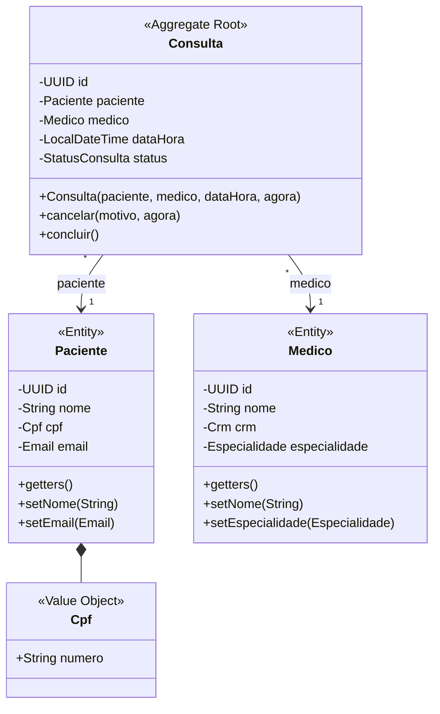
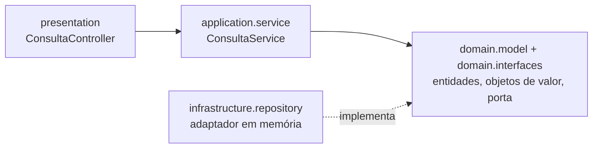

# Hands on: Diagramando e criando as classes com Java

**Live FIAP · Domain Driven Design com Java · Engenharia de Software**

Neste laboratório você vai criar uma **aplicação Java do zero**, começando por uma classe com o método `main` vazio. A partir do **diagrama de classes** de uma clínica médica, vai criar as classes de domínio, proteger as **invariantes de negócio** nos construtores, organizar o código em pacotes, criar a **porta** e o **caso de uso**, implementar o **adaptador em memória** e agendar consultas pelo `main`. No fim, o sistema vira uma **API REST com Spring Boot**, sem alterar uma linha do domínio.

> **Nunca programou em Java?** Sem problema. Cada passo explica os conceitos da linguagem no momento em que eles aparecem. Copie os códigos com atenção: em Java, maiúsculas, minúsculas, `;` e `{ }` fazem diferença.

| | |
|---|---|
| **Duração** | ~2h |
| **Pré-requisitos** | JDK 21, IntelliJ IDEA (Community ou Ultimate), Git |
| **Repositório** | [prof-eduardo-ramos/ddd-java-clinica](https://github.com/prof-eduardo-ramos/ddd-java-clinica) |
| **Branch da atividade** | `lab/diagramando-classes-java` (projeto recém-criado, `main` vazio) |
| **Branch com a solução** | `main` |
| **Atalhos por passo** | tags `passo-1` a `passo-7` |

---

## Sumário

- [Passo 0: Preparando o ambiente](#passo-0-preparando-o-ambiente)
- [Antes de programar: o problema e o modelo](#antes-de-programar-o-problema-e-o-modelo)
- [Passo 1: Criando a aplicação Java do zero](#passo-1-criando-a-aplicação-java-do-zero)
- [Passo 2: Criando as classes de domínio a partir do diagrama](#passo-2-criando-as-classes-de-domínio-a-partir-do-diagrama)
- [Passo 3: Protegendo as invariantes nos construtores](#passo-3-protegendo-as-invariantes-nos-construtores)
- [Passo 4: Porta e caso de uso](#passo-4-porta-e-caso-de-uso)
- [Passo 5: Adaptador em memória](#passo-5-adaptador-em-memória)
- [Passo 6: Agendando consultas no main](#passo-6-agendando-consultas-no-main)
- [Passo 7: API REST com Spring Boot](#passo-7-api-rest-com-spring-boot)
- [Fechamento e próximos passos](#fechamento-e-próximos-passos)
- [Se você se perdeu](#se-você-se-perdeu)

---

## Passo 0: Preparando o ambiente

### 0.1 Instale as ferramentas

| Ferramenta | Para que serve | Onde baixar |
|---|---|---|
| **JDK 21** | Compila e executa o código Java | [Adoptium Temurin 21](https://adoptium.net/) (ou pelo próprio IntelliJ, no passo 1.1) |
| **IntelliJ IDEA** | Editor (IDE) onde vamos escrever o código | [jetbrains.com/idea](https://www.jetbrains.com/idea/download/) |
| **Git** | Versiona o código e baixa o repositório | [git-scm.com](https://git-scm.com/) |

O **Maven**, que baixa bibliotecas e compila o projeto, já vem embutido no IntelliJ.

### 0.2 Confira no terminal

```bash
java -version    # deve mostrar a versão 21
git --version
```

> Se `java -version` mostrar outra versão, não se preocupe: no passo 1.1 o IntelliJ baixa o JDK 21 para o projeto.

**Checkpoint 0:** IntelliJ aberto e JDK 21 disponível.

---

## Antes de programar: o problema e o modelo

### O problema, contado por quem é do negócio

> "Nossa clínica atende **pacientes** com **médicos** de várias **especialidades**. O paciente **agenda uma consulta** com um médico em uma **data e hora**. A clínica funciona de **segunda a sábado, das 7h às 19h**, e cada consulta dura **1 hora**, sempre em hora cheia. Ninguém agenda em cima da hora: precisa de pelo menos **30 minutos de antecedência**. Um médico **não pode ter duas consultas no mesmo horário**. O paciente pode **cancelar**, mas precisa **informar o motivo** e avisar com **24 horas de antecedência**. Depois do atendimento, a consulta é **concluída**."

### Substantivos viram classes, verbos viram métodos

Esse vocabulário compartilhado entre negócio e código é a **linguagem ubíqua**: o mesmo nome na conversa, no diagrama e no código.

| Termo | Tipo no DDD | Pergunta que decide |
|---|---|---|
| Paciente, Médico | **Entidade** | "Preciso distinguir um do outro ao longo do tempo?" Sim → tem **id** |
| Consulta | **Entidade + Agregado raiz** | Tem ciclo de vida e concentra as regras |
| CPF, E-mail, CRM | **Objeto de valor** | "Dois com o mesmo valor são a mesma coisa?" Sim → sem id, imutável |
| Especialidade, Status | **Enum** | Lista fechada de valores |
| agendar, cancelar, concluir | **Construtor e métodos** da Consulta | Comportamento junto dos dados |

### As cinco regras de negócio

| # | Regra | Onde vai morar |
|---|---|---|
| 1 | Antecedência mínima de 30 min para agendar | construtor de `Consulta` (domínio) |
| 2 | Segunda a sábado, 7h–19h, hora cheia (último horário 18h) | construtor de `Consulta` (domínio) |
| 3 | Médico sem duas consultas no mesmo horário | `ConsultaService.agendar()` (aplicação) |
| 4 | Cancelar exige motivo e 24h de antecedência | `Consulta.cancelar()` (domínio) |
| 5 | Só consulta agendada pode ser concluída | `Consulta.concluir()` (domínio) |

### O diagrama de classes



A versão completa está em `docs/diagrama-de-classes.md`. Três decisões importantes:

1. **Associação entre classes**: a `Consulta` **tem um** `Paciente` e **tem um** `Medico`. Os atributos são do tipo dessas classes, e navegamos pelo objeto: `consulta.getPaciente().getNome()`.
2. **O construtor da `Consulta` valida tudo**: não existe consulta inválida.
3. **Atributos privados (`-`), métodos públicos (`+`)**: a `Consulta` não tem setters, então ninguém altera o `status` diretamente.

### As camadas que vamos construir



| Camada | Pacote | O que contém | Passo |
|---|---|---|---|
| Domínio | `domain.model` | Entidades, objetos de valor, enums e a exceção de negócio | 2 e 3 |
| Domínio | `domain.interfaces` | A porta `ConsultaRepository` | 4 |
| Aplicação | `application.service` | O caso de uso `ConsultaService` | 4 |
| Infraestrutura | `infrastructure.repository` | O adaptador `ConsultaRepositoryEmMemoria` | 5 |
| Apresentação | `presentation` | API REST com Spring Boot | 7 |

Vamos construir **de dentro para fora**: primeiro o domínio, que não depende de ninguém, e por último a apresentação.

---|---|---|---|
| Domínio | `domain` | Regras e conceitos do negócio, em Java puro | 2 |
| Aplicação | `application` | Casos de uso que orquestram o domínio | 3 |
| Infraestrutura | `infrastructure` | Implementações técnicas (persistência, configuração) | 4 |
| Apresentação | `presentation` | Entrada HTTP: controllers, DTOs, tratamento de erros | 5 |

Vamos construir **de dentro para fora**: primeiro o domínio, que não depende de ninguém, e por último a apresentação.

---

## Passo 1: Criando a aplicação Java do zero

### 1.1 Crie o projeto no IntelliJ

1. Abra o IntelliJ e clique em **New Project**.
2. Preencha:

| Campo | Valor |
|---|---|
| **Name** | `ddd-java-clinica` |
| **Location** | uma pasta sua, por exemplo `~/workspace` |
| **Language** | Java |
| **Build system** | **Maven** |
| **JDK** | **21** (se não aparecer, escolha *Download JDK…* → versão 21) |
| **Add sample code** | **desmarcado** (vamos criar tudo nós mesmos) |
| **Advanced Settings › GroupId** | `br.com.fiap` |
| **Advanced Settings › ArtifactId** | `ddd-java-clinica` |

3. Clique em **Create**.

> **O que é o Maven?** Uma ferramenta que organiza o projeto, baixa bibliotecas (dependências) e compila o código. Ele é configurado pelo arquivo `pom.xml`.

> **Prefere começar pronto?** O resultado deste passo está na branch da atividade:
> `git clone https://github.com/prof-eduardo-ramos/ddd-java-clinica.git` e depois `git checkout lab/diagramando-classes-java`.

### 1.2 Entenda a estrutura criada

```
ddd-java-clinica
├── pom.xml                ← configuração do projeto (Maven)
└── src
    ├── main
    │   └── java           ← código da aplicação
    └── test
        └── java           ← testes automatizados
```

### 1.3 Crie o pacote e a classe `Main`

Um **pacote** (`package`) é uma pasta que agrupa classes relacionadas. Por convenção, o nome começa pelo domínio da organização ao contrário: `br.com.fiap`, seguido do nome do sistema.

1. Clique com o botão direito em `src/main/java` → **New › Package** → digite `br.com.fiap.clinica`.
2. Clique com o botão direito no pacote criado → **New › Java Class** → digite `Main`.
3. Deixe a classe assim:

```java
package br.com.fiap.clinica;

/**
 * Ponto de partida de toda aplicação Java: o método main.
 * Por enquanto ele está vazio. Nos próximos passos vamos usá-lo
 * para testar as classes que criarmos.
 */
public class Main {

    public static void main(String[] args) {

    }
}
```

**Anatomia do `main`, palavra por palavra:**

| Trecho | Significado |
|---|---|
| `package br.com.fiap.clinica;` | Em qual pacote (pasta) esta classe está |
| `public class Main` | Declara uma **classe** pública chamada `Main`. O nome do arquivo deve ser igual: `Main.java` |
| `public` | Pode ser acessado de qualquer lugar |
| `static` | Pertence à classe, não a um objeto. A JVM chama o `main` sem criar um `Main` antes |
| `void` | O método não devolve nenhum valor |
| `main(String[] args)` | Nome obrigatório do ponto de entrada; `args` recebe argumentos da linha de comando |
| `{ }` | Delimitam o corpo da classe e do método |
| `/** ... */` e `//` | Comentários: ignorados pelo compilador |

> **Atalho do IntelliJ:** dentro da classe, digite `psvm` + **Tab** para gerar o `main`. E `sout` + **Tab** gera um `System.out.println()`.

### 1.4 Execute pela primeira vez

Clique no **▶ verde** ao lado do `main` → **Run 'Main.main()'**. O console mostra:

```
Process finished with exit code 0
```

`exit code 0` significa que o programa rodou sem erros. Ele não imprimiu nada porque o `main` está vazio, e é isso mesmo que queremos agora.

### 1.5 Configure o `pom.xml`

Substitua o conteúdo do `pom.xml` para fixar o Java 21 e adicionar o **JUnit**, a biblioteca de testes automatizados:

```xml
<?xml version="1.0" encoding="UTF-8"?>
<project xmlns="http://maven.apache.org/POM/4.0.0"
         xmlns:xsi="http://www.w3.org/2001/XMLSchema-instance"
         xsi:schemaLocation="http://maven.apache.org/POM/4.0.0 https://maven.apache.org/xsd/maven-4.0.0.xsd">
    <modelVersion>4.0.0</modelVersion>

    <groupId>br.com.fiap</groupId>
    <artifactId>ddd-java-clinica</artifactId>
    <version>1.0.0</version>
    <name>ddd-java-clinica</name>
    <description>Live FIAP - Diagramando e criando as classes com Java (DDD)</description>

    <!-- Passos 1 a 6: Java puro. Nenhum framework, só JUnit para os testes. -->
    <properties>
        <java.version>21</java.version>
        <maven.compiler.release>21</maven.compiler.release>
        <project.build.sourceEncoding>UTF-8</project.build.sourceEncoding>
    </properties>

    <dependencyManagement>
        <dependencies>
            <dependency>
                <groupId>org.junit</groupId>
                <artifactId>junit-bom</artifactId>
                <version>6.0.3</version>
                <type>pom</type>
                <scope>import</scope>
            </dependency>
        </dependencies>
    </dependencyManagement>

    <dependencies>
        <dependency>
            <groupId>org.junit.jupiter</groupId>
            <artifactId>junit-jupiter</artifactId>
            <scope>test</scope>
        </dependency>
    </dependencies>

    <build>
        <plugins>
            <plugin>
                <groupId>org.apache.maven.plugins</groupId>
                <artifactId>maven-compiler-plugin</artifactId>
                <version>3.14.1</version>
            </plugin>
            <plugin>
                <groupId>org.apache.maven.plugins</groupId>
                <artifactId>maven-surefire-plugin</artifactId>
                <version>3.5.4</version>
            </plugin>
            <plugin>
                <groupId>org.apache.maven.plugins</groupId>
                <artifactId>maven-resources-plugin</artifactId>
                <version>3.3.1</version>
            </plugin>
        </plugins>
    </build>
</project>
```

Depois de salvar, clique em **Load Maven Changes** (o ícone do "m" com setas, no canto do editor).

### 1.6 Java essencial para os próximos passos

| Conceito | Exemplo | Em uma frase |
|---|---|---|
| **Classe** | `public class Paciente { }` | O molde de um conceito |
| **Objeto** | `new Paciente(...)` | Uma instância criada a partir da classe |
| **Atributo** | `private String nome;` | Um dado que o objeto guarda |
| **Construtor** | `public Paciente(String nome, ...) { }` | Código que roda ao criar o objeto |
| **Método** | `public void alterarEmail(Email novo) { }` | Um comportamento do objeto |
| **`private` / `public`** | | Visível só dentro da classe / visível para todos |
| **`final`** | `private final UUID id;` | Depois de atribuído, não muda mais |
| **`static`** | `Consulta.agendar(...)` | Pertence à classe, chamado sem objeto |
| **`import`** | `import java.util.UUID;` | Usa uma classe de outro pacote |
| **Exceção** | `throw new RegraDeNegocioException("...")` | Interrompe a execução sinalizando um erro |

**Checkpoint 1:** projeto criado, `Main` com `main` vazio executando com `exit code 0`. *(tag `passo-1`)*

---

## Passo 2: Criando as classes de domínio a partir do diagrama

Neste passo vamos transformar o **diagrama de classes** em código. Só a **estrutura**: atributos, getters e, quando fizer sentido, setters. **Nenhuma regra de negócio ainda.** As regras entram no Passo 3.

> Por enquanto, todas as classes ficam no mesmo pacote do `Main`: `br.com.fiap.clinica`. No fim do Passo 3 vamos organizá-las em um pacote próprio.

### 2.1 Do diagrama para o código

| No diagrama | Tipo em Java | Como criar no IntelliJ |
|---|---|---|
| `Especialidade`, `StatusConsulta` (`<<enumeration>>`) | `enum` | **New › Java Class › Enum** |
| `Cpf`, `Email`, `Crm` (`<<Value Object>>`) | `record` | **New › Java Class › Record** |
| `Paciente`, `Medico` (`<<Entity>>`) | `class` | **New › Java Class › Class** |
| `Consulta` (`<<Aggregate Root>>`) | `class` | **New › Java Class › Class** |

Para criar: clique com o botão direito no pacote `br.com.fiap.clinica` → **New › Java Class**, digite o nome e escolha o tipo.

### 2.2 Enums: listas fechadas de valores

Um `enum` é um tipo com uma lista fixa de valores. Não existe uma especialidade "inventada": só as que estão na lista.

```java
package br.com.fiap.clinica;

public enum Especialidade {
    CLINICA_GERAL,
    CARDIOLOGIA,
    DERMATOLOGIA,
    ORTOPEDIA,
    PEDIATRIA
}
```

```java
package br.com.fiap.clinica;

public enum StatusConsulta {
    AGENDADA,
    CANCELADA,
    REALIZADA
}
```

### 2.3 Objetos de valor: records

Um `record` é uma classe **imutável** em que você declara só os atributos, entre parênteses. O Java cria sozinho o construtor, os **getters** (com o mesmo nome do atributo: `numero()`, `endereco()`), o `equals`, o `hashCode` e o `toString`. Objeto de valor **não tem setter**: para "mudar" um CPF, cria-se outro.

```java
package br.com.fiap.clinica;

public record Cpf(String numero) {
}
```

```java
package br.com.fiap.clinica;

public record Email(String endereco) {
}
```

```java
package br.com.fiap.clinica;

public record Crm(String numero, String uf) {
}
```

### 2.4 Entidades: atributos, getters e setters

Os atributos são **privados** (`private`): ninguém de fora da classe mexe neles diretamente. Isso se chama **encapsulamento**. O acesso acontece por métodos públicos:

- **getter** (`getNome()`): devolve o valor do atributo.
- **setter** (`setNome(...)`): altera o valor do atributo.

Só criamos setter **quando faz sentido o valor mudar** depois que o objeto existe:

| Classe | Atributo | Getter | Setter | Por quê |
|---|---|---|---|---|
| `Paciente` | `id` | ✔ | ✘ | A identidade nunca muda |
| `Paciente` | `nome` | ✔ | ✔ | O paciente pode corrigir o nome |
| `Paciente` | `cpf` | ✔ | ✘ | O CPF de uma pessoa não muda |
| `Paciente` | `email` | ✔ | ✔ | O paciente pode trocar de e-mail |
| `Medico` | `id`, `crm` | ✔ | ✘ | Identidade e registro profissional não mudam |
| `Medico` | `nome`, `especialidade` | ✔ | ✔ | Podem ser atualizados |
| `Consulta` | todos | ✔ | ✘ | O status só muda pelas regras do negócio (Passo 3) |

> **Atalho:** dentro da classe, depois de declarar os atributos, use **Code › Generate** (**Cmd+N** no Mac, **Alt+Insert** no Windows) › **Getter and Setter** e marque só os que você quer.

O `id` é um **UUID**, um identificador único gerado pelo Java com `UUID.randomUUID()`. A palavra `this` significa "este objeto": `this.nome = nome` guarda o valor recebido no atributo do objeto.

**`Paciente`**

```java
package br.com.fiap.clinica;

import java.util.UUID;

public class Paciente {

    private UUID id = UUID.randomUUID();
    private String nome;
    private Cpf cpf;
    private Email email;

    public UUID getId() {
        return id;
    }

    public String getNome() {
        return nome;
    }

    public void setNome(String nome) {
        this.nome = nome;
    }

    public Cpf getCpf() {
        return cpf;
    }

    public Email getEmail() {
        return email;
    }

    public void setEmail(Email email) {
        this.email = email;
    }
}
```

**`Medico`**

```java
package br.com.fiap.clinica;

import java.util.UUID;

public class Medico {

    private UUID id = UUID.randomUUID();
    private String nome;
    private Crm crm;
    private Especialidade especialidade;

    public UUID getId() {
        return id;
    }

    public String getNome() {
        return nome;
    }

    public void setNome(String nome) {
        this.nome = nome;
    }

    public Crm getCrm() {
        return crm;
    }

    public Especialidade getEspecialidade() {
        return especialidade;
    }

    public void setEspecialidade(Especialidade especialidade) {
        this.especialidade = especialidade;
    }
}
```

### 2.5 O agregado `Consulta`: só getters

A `Consulta` se relaciona com as outras classes por **associação**: ela **tem um** `Paciente` e **tem um** `Medico`. Na prática, isso é só um atributo cujo tipo é outra classe do nosso modelo:

```java
private Paciente paciente;   // a consulta TEM UM paciente
private Medico medico;       // a consulta TEM UM médico
```

Com o objeto em mãos, navegamos pelo relacionamento: `consulta.getPaciente().getNome()`.

| Relacionamento | No diagrama | Exemplo | Em Java |
|---|---|---|---|
| **Associação** | seta `-->` | `Consulta` tem um `Paciente` | atributo `private Paciente paciente;` |
| **Composição** | losango `*--` | `Paciente` tem um `Cpf`, que só existe dentro dele | atributo `private Cpf cpf;` |

E a `Consulta` não tem setters: ninguém deve conseguir fazer `consulta.setStatus(REALIZADA)` numa consulta cancelada.

```java
package br.com.fiap.clinica;

import java.time.LocalDateTime;
import java.util.UUID;

public class Consulta {

    private UUID id = UUID.randomUUID();
    private Paciente paciente;
    private Medico medico;
    private LocalDateTime dataHora;
    private StatusConsulta status;
    private String motivoCancelamento;

    // Sem setters: o status de uma consulta só pode mudar seguindo as regras
    // do negócio (agendar, cancelar, concluir). Isso entra no Passo 3.

    public UUID getId() {
        return id;
    }

    public Paciente getPaciente() {
        return paciente;
    }

    public Medico getMedico() {
        return medico;
    }

    public LocalDateTime getDataHora() {
        return dataHora;
    }

    public StatusConsulta getStatus() {
        return status;
    }

    public String getMotivoCancelamento() {
        return motivoCancelamento;
    }
}
```

### 2.6 Testando no `main`: o problema aparece

```java
package br.com.fiap.clinica;

public class Main {

    public static void main(String[] args) {
        Paciente paciente = new Paciente();
        paciente.setNome("Ana Souza");
        paciente.setEmail(new Email("ana@email.com"));

        System.out.println("Paciente: " + paciente.getNome());
        System.out.println("E-mail: " + paciente.getEmail().endereco());
        System.out.println("Id: " + paciente.getId());

        // O problema: o modelo aceita qualquer coisa!
        paciente.setNome("");
        Cpf cpf = new Cpf("123");
        Email email = new Email("isso-nao-e-um-email");

        System.out.println("Nome vazio aceito: '" + paciente.getNome() + "'");
        System.out.println("CPF inválido aceito: " + cpf.numero());
        System.out.println("E-mail inválido aceito: " + email.endereco());
    }
}
```

Saída:

```
Paciente: Ana Souza
E-mail: ana@email.com
Id: 3f1c...  (um UUID diferente a cada execução)
Nome vazio aceito: ''
CPF inválido aceito: 123
E-mail inválido aceito: isso-nao-e-um-email
```

As classes funcionam, mas **aceitam qualquer coisa**: nome vazio, CPF com 3 dígitos, e-mail sem `@`. Um objeto assim está num **estado inválido**. É isso que o Passo 3 resolve.

**Checkpoint 2:** as 8 classes do diagrama criadas e o `main` rodando. *(tag `passo-2`)*

---

## Passo 3: Protegendo as invariantes nos construtores

### 3.1 O que é um método construtor?

O **construtor** é um método especial que roda **no momento em que o objeto é criado** com `new`.

```java
public class Paciente {
    private String nome;

    public Paciente(String nome) {   // construtor
        this.nome = nome;
    }
}

Paciente ana = new Paciente("Ana Souza");   // o construtor roda aqui
```

| Característica | Explicação |
|---|---|
| Mesmo nome da classe | `Paciente(...)` dentro de `class Paciente` |
| Sem tipo de retorno | Não tem `void` nem outro tipo antes do nome |
| Chamado pelo `new` | Não se chama um construtor como um método comum |
| Recebe parâmetros | Os dados necessários para o objeto nascer completo |
| Construtor padrão | Se você não escrever nenhum, o Java cria um vazio: foi o que usamos no Passo 2 (`new Paciente()`) |

### 3.2 O que são invariantes de negócio?

**Invariante** é uma regra que precisa ser **verdadeira durante toda a vida do objeto**: do momento em que ele nasce até o momento em que deixa de existir.

| Classe | Invariante |
|---|---|
| `Cpf` | Tem 11 dígitos e dígitos verificadores válidos |
| `Email` | Tem formato de e-mail |
| `Paciente` | Tem nome com pelo menos 3 caracteres, CPF e e-mail |
| `Consulta` | Foi marcada com 30 min de antecedência, de segunda a sábado, das 7h às 18h, em hora cheia (regras 1 e 2) |
| `Consulta` | Só é cancelada com motivo e 24h de antecedência; só é concluída se estiver agendada (regras 4 e 5) |

**Onde proteger?** No **construtor** (o objeto já nasce válido) e em todo método que **altera o estado** (setters, `cancelar()`, `concluir()`). Se a regra for violada, o método **lança uma exceção** e o objeto inválido nunca chega a existir.

### 3.3 A exceção de negócio

No pacote `br.com.fiap.clinica`, crie `RegraDeNegocioException`. Ela **herda** (`extends`) de `RuntimeException`, a exceção padrão do Java, e só ganha um nome que faz sentido para o negócio.

```java
package br.com.fiap.clinica;

/**
 * Lançada quando uma invariante de negócio é violada.
 * Ex.: CPF inválido, nome vazio, consulta marcada para domingo.
 */
public class RegraDeNegocioException extends RuntimeException {

    public RegraDeNegocioException(String mensagem) {
        super(mensagem);
    }
}
```

### 3.4 Objetos de valor que se validam sozinhos

No `record`, o **construtor compacto** (`public Email { ... }`, sem parênteses) roda antes de guardar os valores: é o lugar para **validar e normalizar**.

**`Email`**

```java
package br.com.fiap.clinica;

/** Objeto de valor que representa um e-mail válido, sempre em minúsculas. */
public record Email(String endereco) {

    private static final String FORMATO = "^[\\w.+-]+@[\\w-]+(\\.[\\w-]+)+$";

    public Email {
        if (endereco == null || endereco.isBlank()) {
            throw new RegraDeNegocioException("E-mail é obrigatório");
        }
        endereco = endereco.trim().toLowerCase();
        if (!endereco.matches(FORMATO)) {
            throw new RegraDeNegocioException("E-mail inválido: " + endereco);
        }
    }
}
```

**`Crm`**

```java
package br.com.fiap.clinica;

/** Objeto de valor composto: o CRM só faz sentido com número E estado (UF). */
public record Crm(String numero, String uf) {

    public Crm {
        if (numero == null || !numero.matches("\\d{4,6}")) {
            throw new RegraDeNegocioException("CRM deve ter de 4 a 6 dígitos");
        }
        if (uf == null || !uf.trim().matches("[A-Za-z]{2}")) {
            throw new RegraDeNegocioException("UF do CRM deve ter 2 letras");
        }
        uf = uf.trim().toUpperCase();
    }

    @Override
    public String toString() {
        return "CRM/" + uf + " " + numero;
    }
}
```

**`Cpf`**: além do construtor, ganha métodos `private static` que calculam os dígitos verificadores e o método `formatado()`.

```java
package br.com.fiap.clinica;

/**
 * Objeto de valor: não tem identidade própria, é definido pelo seu valor.
 * Dois CPFs com o mesmo número são iguais (o record gera equals/hashCode).
 * Se o objeto existe, ele é válido: a validação acontece no construtor.
 */
public record Cpf(String numero) {

    public Cpf {
        if (numero == null || numero.isBlank()) {
            throw new RegraDeNegocioException("CPF é obrigatório");
        }
        numero = numero.replaceAll("\\D", ""); // remove pontos e traço
        if (!numero.matches("\\d{11}") || todosDigitosIguais(numero) || !digitosVerificadoresValidos(numero)) {
            throw new RegraDeNegocioException("CPF inválido: " + numero);
        }
    }

    /** Retorna o CPF no formato 000.000.000-00. */
    public String formatado() {
        return numero.substring(0, 3) + "." + numero.substring(3, 6) + "."
                + numero.substring(6, 9) + "-" + numero.substring(9);
    }

    private static boolean todosDigitosIguais(String cpf) {
        return cpf.chars().distinct().count() == 1;
    }

    private static boolean digitosVerificadoresValidos(String cpf) {
        return calcularDigito(cpf, 9) == Character.getNumericValue(cpf.charAt(9))
                && calcularDigito(cpf, 10) == Character.getNumericValue(cpf.charAt(10));
    }

    private static int calcularDigito(String cpf, int quantidadeDigitos) {
        int soma = 0;
        int peso = quantidadeDigitos + 1;
        for (int i = 0; i < quantidadeDigitos; i++) {
            soma += Character.getNumericValue(cpf.charAt(i)) * peso--;
        }
        int resto = soma % 11;
        return resto < 2 ? 0 : 11 - resto;
    }
}
```

### 3.5 Entidades com construtor

Mudanças em relação ao Passo 2:

1. Os atributos que não mudam ganham `final` (só podem receber valor uma vez, no construtor).
2. Entra um **construtor** que recebe tudo o que o objeto precisa para nascer válido.
3. Os **setters validam** antes de alterar. O construtor reaproveita os setters para não repetir a regra.

**`Paciente`**

```java
package br.com.fiap.clinica;

import java.util.UUID;

/**
 * Entidade: tem identidade (id) que não muda, mesmo que os outros dados mudem.
 */
public class Paciente {

    private final UUID id;
    private String nome;
    private final Cpf cpf;
    private Email email;

    // Construtor: só existe paciente com nome, CPF e e-mail válidos
    public Paciente(String nome, Cpf cpf, Email email) {
        if (cpf == null) {
            throw new RegraDeNegocioException("CPF é obrigatório");
        }
        this.id = UUID.randomUUID();
        this.cpf = cpf;
        setNome(nome);
        setEmail(email);
    }

    public UUID getId() {
        return id;
    }

    public String getNome() {
        return nome;
    }

    // O setter também protege a invariante: nome com pelo menos 3 caracteres
    public void setNome(String nome) {
        if (nome == null || nome.trim().length() < 3) {
            throw new RegraDeNegocioException("Nome do paciente deve ter ao menos 3 caracteres");
        }
        this.nome = nome.trim();
    }

    public Cpf getCpf() {
        return cpf;
    }

    public Email getEmail() {
        return email;
    }

    public void setEmail(Email email) {
        if (email == null) {
            throw new RegraDeNegocioException("E-mail é obrigatório");
        }
        this.email = email;
    }
}
```

**`Medico`**

```java
package br.com.fiap.clinica;

import java.util.UUID;

/**
 * Entidade que representa um médico da clínica.
 */
public class Medico {

    private final UUID id;
    private String nome;
    private final Crm crm;
    private Especialidade especialidade;

    public Medico(String nome, Crm crm, Especialidade especialidade) {
        if (crm == null) {
            throw new RegraDeNegocioException("CRM é obrigatório");
        }
        this.id = UUID.randomUUID();
        this.crm = crm;
        setNome(nome);
        setEspecialidade(especialidade);
    }

    public UUID getId() {
        return id;
    }

    public String getNome() {
        return nome;
    }

    public void setNome(String nome) {
        if (nome == null || nome.trim().length() < 3) {
            throw new RegraDeNegocioException("Nome do médico deve ter ao menos 3 caracteres");
        }
        this.nome = nome.trim();
    }

    public Crm getCrm() {
        return crm;
    }

    public Especialidade getEspecialidade() {
        return especialidade;
    }

    public void setEspecialidade(Especialidade especialidade) {
        if (especialidade == null) {
            throw new RegraDeNegocioException("Especialidade é obrigatória");
        }
        this.especialidade = especialidade;
    }
}
```

### 3.6 O agregado `Consulta`

O construtor valida as **regras 1 e 2**. Repare que o "agora" vem por **parâmetro**: assim conseguimos testar com uma data fixa. Os métodos `cancelar()` e `concluir()` protegem as **regras 4 e 5**, e são a única forma de mudar o status.

```java
package br.com.fiap.clinica;

import java.time.DayOfWeek;
import java.time.Duration;
import java.time.LocalDateTime;
import java.time.LocalTime;
import java.util.UUID;

/**
 * Agregado raiz: toda regra sobre a consulta mora AQUI.
 * Associação: uma consulta TEM um paciente e TEM um médico.
 */
public class Consulta {

    public static final LocalTime PRIMEIRO_HORARIO = LocalTime.of(7, 0);
    public static final LocalTime ULTIMO_HORARIO = LocalTime.of(18, 0); // consulta de 1h termina às 19h
    public static final Duration ANTECEDENCIA_MINIMA_AGENDAMENTO = Duration.ofMinutes(30);
    public static final Duration ANTECEDENCIA_MINIMA_CANCELAMENTO = Duration.ofHours(24);

    private final UUID id;
    private final Paciente paciente;
    private final Medico medico;
    private final LocalDateTime dataHora;
    private StatusConsulta status;
    private String motivoCancelamento;

    /**
     * Construtor: toda consulta nasce AGENDADA e já validada.
     * O "agora" vem de fora para que as regras de tempo sejam testáveis.
     */
    public Consulta(Paciente paciente, Medico medico, LocalDateTime dataHora, LocalDateTime agora) {
        if (paciente == null) {
            throw new RegraDeNegocioException("Paciente é obrigatório");
        }
        if (medico == null) {
            throw new RegraDeNegocioException("Médico é obrigatório");
        }
        if (dataHora == null || agora == null) {
            throw new RegraDeNegocioException("Data e hora são obrigatórias");
        }
        validarAntecedencia(dataHora, agora);        // Regra 1
        validarHorarioDeFuncionamento(dataHora);     // Regra 2

        this.id = UUID.randomUUID();
        this.paciente = paciente;
        this.medico = medico;
        this.dataHora = dataHora;
        this.status = StatusConsulta.AGENDADA;
    }

    // Regra 4: cancelamento exige motivo e 24h de antecedência
    public void cancelar(String motivo, LocalDateTime agora) {
        if (status != StatusConsulta.AGENDADA) {
            throw new RegraDeNegocioException("Só é possível cancelar uma consulta agendada");
        }
        if (motivo == null || motivo.isBlank()) {
            throw new RegraDeNegocioException("Motivo do cancelamento é obrigatório");
        }
        if (agora.plus(ANTECEDENCIA_MINIMA_CANCELAMENTO).isAfter(dataHora)) {
            throw new RegraDeNegocioException("Cancelamento exige 24 horas de antecedência");
        }
        this.status = StatusConsulta.CANCELADA;
        this.motivoCancelamento = motivo.trim();
    }

    // Regra 5: só consulta agendada pode ser concluída
    public void concluir() {
        if (status != StatusConsulta.AGENDADA) {
            throw new RegraDeNegocioException("Só é possível concluir uma consulta agendada");
        }
        this.status = StatusConsulta.REALIZADA;
    }

    public boolean estaAgendada() {
        return status == StatusConsulta.AGENDADA;
    }

    private static void validarAntecedencia(LocalDateTime dataHora, LocalDateTime agora) {
        if (agora.plus(ANTECEDENCIA_MINIMA_AGENDAMENTO).isAfter(dataHora)) {
            throw new RegraDeNegocioException("Consulta deve ser agendada com 30 minutos de antecedência");
        }
    }

    private static void validarHorarioDeFuncionamento(LocalDateTime dataHora) {
        if (dataHora.getDayOfWeek() == DayOfWeek.SUNDAY) {
            throw new RegraDeNegocioException("A clínica não funciona aos domingos");
        }
        LocalTime horario = dataHora.toLocalTime();
        if (horario.isBefore(PRIMEIRO_HORARIO) || horario.isAfter(ULTIMO_HORARIO)) {
            throw new RegraDeNegocioException("Consultas acontecem entre 7h e 19h (último horário: 18h)");
        }
        if (horario.getMinute() != 0 || horario.getSecond() != 0) {
            throw new RegraDeNegocioException("Consultas começam sempre em hora cheia (ex.: 09:00)");
        }
    }

    public UUID getId() {
        return id;
    }

    public Paciente getPaciente() {
        return paciente;
    }

    public Medico getMedico() {
        return medico;
    }

    public LocalDateTime getDataHora() {
        return dataHora;
    }

    public StatusConsulta getStatus() {
        return status;
    }

    public String getMotivoCancelamento() {
        return motivoCancelamento;
    }
}
```

### 3.7 Organizando: o pacote `domain.model`

As classes de domínio estão misturadas com o `Main`. Vamos dar a elas um pacote próprio:

1. Clique com o botão direito em `br.com.fiap.clinica` → **New › Package** → `br.com.fiap.clinica.domain.model`.
2. Selecione as 9 classes de domínio (segure **Cmd** no Mac ou **Ctrl** no Windows e clique em cada uma): `Consulta`, `Cpf`, `Crm`, `Email`, `Especialidade`, `Medico`, `Paciente`, `RegraDeNegocioException` e `StatusConsulta`.
3. Arraste para o pacote `domain.model` (ou **F6** / **Refactor › Move**) e confirme em **Refactor**.

O IntelliJ atualiza a linha `package` de cada classe e os `import` do `Main` automaticamente.

```
br.com.fiap.clinica
├── Main
└── domain
    └── model
        ├── Consulta
        ├── Cpf
        ├── Crm
        ├── Email
        ├── Especialidade
        ├── Medico
        ├── Paciente
        ├── RegraDeNegocioException
        └── StatusConsulta
```

### 3.8 Testando no `main`: o modelo se protege

```java
package br.com.fiap.clinica;

import br.com.fiap.clinica.domain.model.Cpf;
import br.com.fiap.clinica.domain.model.Crm;
import br.com.fiap.clinica.domain.model.Email;
import br.com.fiap.clinica.domain.model.Especialidade;
import br.com.fiap.clinica.domain.model.Medico;
import br.com.fiap.clinica.domain.model.Paciente;
import br.com.fiap.clinica.domain.model.RegraDeNegocioException;

public class Main {

    public static void main(String[] args) {
        Paciente ana = new Paciente("Ana Souza", new Cpf("529.982.247-25"), new Email("ana@email.com"));
        Medico carlos = new Medico("Carlos Lima", new Crm("123456", "SP"), Especialidade.CARDIOLOGIA);

        System.out.println("Paciente: " + ana.getNome() + " - CPF " + ana.getCpf().formatado());
        System.out.println("Médico: " + carlos.getNome() + " - " + carlos.getCrm());

        // Agora o modelo se protege: dados inválidos geram exceção
        try {
            ana.setNome("");
        } catch (RegraDeNegocioException e) {
            System.out.println("Invariante protegida: " + e.getMessage());
        }
        try {
            new Cpf("123");
        } catch (RegraDeNegocioException e) {
            System.out.println("Invariante protegida: " + e.getMessage());
        }
    }
}
```

Saída:

```
Paciente: Ana Souza - CPF 529.982.247-25
Médico: Carlos Lima - CRM/SP 123456
Invariante protegida: Nome do paciente deve ter ao menos 3 caracteres
Invariante protegida: CPF inválido: 123
```

> **Experimente:** tente criar uma `Consulta` para um domingo e veja a exceção.

### 3.9 Para conferir: testes automatizados (opcional)

Na branch `main` (ou na tag `passo-3`), a pasta `src/test/java/br/com/fiap/clinica/domain/model` tem testes **JUnit** para cada invariante. Copie para o seu projeto e rode com `mvn test`. Exemplo:

```java
@Test
@DisplayName("Regra 2: não funciona aos domingos")
void naoAgendaNoDomingo() {
    LocalDateTime domingo = LocalDateTime.of(2026, 11, 8, 10, 0);
    assertThrows(RegraDeNegocioException.class,
            () -> new Consulta(paciente, medico, domingo, AGORA));
}
```

**Checkpoint 3:** classes em `domain.model`, invariantes protegidas e **30 testes verdes**. *(tag `passo-3`)*

---

## Passo 4: Porta e caso de uso

Agora precisamos **guardar** as consultas e aplicar a **regra 3** (médico sem duas consultas no mesmo horário). Essa regra depende das **outras** consultas, e uma consulta sozinha não conhece as outras. Por isso ela fica num **caso de uso**, que usa um **repositório**.

Vamos criar só uma classe de cada: a porta `ConsultaRepository` e o caso de uso `ConsultaService`. Como no Passo 3, criamos primeiro no pacote `br.com.fiap.clinica` e organizamos no fim.

### 4.1 A porta: interface `ConsultaRepository`

Uma `interface` é um **contrato**: diz **quais** métodos existem, sem dizer **como** funcionam. O domínio diz "preciso salvar e buscar consultas"; quem decide se é na memória ou num banco é a infraestrutura (Passo 5).

Crie em `br.com.fiap.clinica` (**New › Java Class › Interface**):

```java
package br.com.fiap.clinica;

import br.com.fiap.clinica.domain.model.Consulta;
import br.com.fiap.clinica.domain.model.Medico;

import java.time.LocalDateTime;
import java.util.List;
import java.util.Optional;
import java.util.UUID;

/**
 * Porta: o domínio diz O QUE precisa para guardar consultas.
 * COMO isso é feito (memória, banco de dados...) fica na infraestrutura.
 */
public interface ConsultaRepository {

    Consulta salvar(Consulta consulta);

    Optional<Consulta> buscarPorId(UUID id);

    List<Consulta> listarTodas();

    boolean existeConsultaAgendadaParaMedico(Medico medico, LocalDateTime dataHora);
}
```

| Método | Para que serve |
|---|---|
| `salvar` | Guarda (ou atualiza) uma consulta |
| `buscarPorId` | Procura uma consulta. Devolve `Optional`: "pode ter uma consulta ou estar vazio" |
| `listarTodas` | Devolve todas as consultas |
| `existeConsultaAgendadaParaMedico` | Responde se o médico já tem consulta naquele horário (regra 3) |

### 4.2 O caso de uso: `ConsultaService`

Primeiro, a exceção para quando a consulta procurada não existe:

```java
package br.com.fiap.clinica;

/** Lançada quando a consulta procurada não existe. */
public class RecursoNaoEncontradoException extends RuntimeException {

    public RecursoNaoEncontradoException(String mensagem) {
        super(mensagem);
    }
}
```

Agora o caso de uso. Dois conceitos novos:

- **Injeção de dependência:** o service **recebe** o repositório pelo construtor, em vez de criá-lo. Ele só conhece a interface, nunca a implementação.
- **`Clock`:** informa "que horas são" de um jeito que os testes conseguem controlar.

```java
package br.com.fiap.clinica;

import br.com.fiap.clinica.domain.model.Consulta;
import br.com.fiap.clinica.domain.model.Medico;
import br.com.fiap.clinica.domain.model.Paciente;
import br.com.fiap.clinica.domain.model.RegraDeNegocioException;

import java.time.Clock;
import java.time.LocalDateTime;
import java.util.List;
import java.util.UUID;

/**
 * Caso de uso: orquestra o domínio e o repositório.
 * Não sabe se as consultas estão na memória ou num banco de dados.
 */
public class ConsultaService {

    private final ConsultaRepository repository;
    private final Clock relogio;

    // Injeção de dependência: o service recebe o repositório pronto
    public ConsultaService(ConsultaRepository repository, Clock relogio) {
        this.repository = repository;
        this.relogio = relogio;
    }

    public Consulta agendar(Paciente paciente, Medico medico, LocalDateTime dataHora) {
        // Regra 3: depende das OUTRAS consultas, por isso fica no caso de uso
        if (repository.existeConsultaAgendadaParaMedico(medico, dataHora)) {
            throw new RegraDeNegocioException("Médico já possui consulta neste horário");
        }
        Consulta consulta = new Consulta(paciente, medico, dataHora, agora());
        return repository.salvar(consulta);
    }

    public Consulta cancelar(UUID consultaId, String motivo) {
        Consulta consulta = buscar(consultaId);
        consulta.cancelar(motivo, agora());
        return repository.salvar(consulta);
    }

    public Consulta concluir(UUID consultaId) {
        Consulta consulta = buscar(consultaId);
        consulta.concluir();
        return repository.salvar(consulta);
    }

    public Consulta buscar(UUID consultaId) {
        return repository.buscarPorId(consultaId)
                .orElseThrow(() -> new RecursoNaoEncontradoException("Consulta não encontrada: " + consultaId));
    }

    public List<Consulta> listar() {
        return repository.listarTodas();
    }

    private LocalDateTime agora() {
        return LocalDateTime.now(relogio);
    }
}
```

Repare que o service é **fino**: ele busca, chama o domínio (`new Consulta(...)`, `consulta.cancelar(...)`) e salva. As regras continuam dentro da `Consulta`.

### 4.3 Organizando: `domain.interfaces` e `application.service`

1. Crie o pacote `br.com.fiap.clinica.domain.interfaces` e mova para ele a interface `ConsultaRepository` (a porta faz parte do domínio).
2. Crie o pacote `br.com.fiap.clinica.application.service` e mova para ele `ConsultaService` e `RecursoNaoEncontradoException`.

```
br.com.fiap.clinica
├── Main
├── application
│   └── service
│       ├── ConsultaService
│       └── RecursoNaoEncontradoException
└── domain
    ├── interfaces
    │   └── ConsultaRepository
    └── model
        └── ...
```

### 4.4 Compile

```bash
mvn compile
```

Ainda não dá para **usar** o `ConsultaService`: a interface `ConsultaRepository` não tem implementação. É o próximo passo.

**Checkpoint 4:** porta e caso de uso criados e organizados, projeto compilando. *(tag `passo-4`)*

---

## Passo 5: Adaptador em memória

O **adaptador** é a classe que **implementa** a porta com uma tecnologia concreta. Hoje vamos guardar as consultas **na memória**, num `Map`. Os dados somem quando o programa termina, e tudo bem: o objetivo é ver as camadas funcionando. Trocar por um banco de dados depois não muda nada no domínio.

### 5.1 Crie o pacote e a classe

1. Crie o pacote `br.com.fiap.clinica.infrastructure.repository`.
2. Crie a classe `ConsultaRepositoryEmMemoria` e declare que ela **implementa** a porta:

```java
public class ConsultaRepositoryEmMemoria implements ConsultaRepository {
}
```

O IntelliJ sublinha a classe em vermelho: ela prometeu cumprir o contrato, mas ainda não tem os métodos. Coloque o cursor no nome da classe, pressione **Alt+Enter** (**Option+Enter** no Mac) › **Implement methods** › **OK**. O IntelliJ cria os 4 métodos com `@Override`, que marca "este método cumpre o contrato da interface".

### 5.2 Onde guardar: um `Map`

Um `Map` guarda pares **chave → valor**, como um dicionário. A chave é o `id` da consulta e o valor é a própria consulta.

```java
private final Map<UUID, Consulta> consultas = new HashMap<>();
```

### 5.3 `salvar`

`put` guarda a consulta com o id como chave. Se a chave já existir, substitui: por isso o mesmo método serve para salvar e para atualizar.

```java
@Override
public Consulta salvar(Consulta consulta) {
    consultas.put(consulta.getId(), consulta);
    return consulta;
}
```

### 5.4 `buscarPorId`

`get` devolve a consulta ou `null` se não existir. `Optional.ofNullable` transforma isso num `Optional`, que é o que a porta promete.

```java
@Override
public Optional<Consulta> buscarPorId(UUID id) {
    return Optional.ofNullable(consultas.get(id));
}
```

### 5.5 `listarTodas`

Devolve uma **cópia** da lista de valores, para que ninguém de fora altere o `Map` por engano.

```java
@Override
public List<Consulta> listarTodas() {
    return new ArrayList<>(consultas.values());
}
```

### 5.6 `existeConsultaAgendadaParaMedico`

Percorre todas as consultas com um `for` e responde `true` se encontrar uma **agendada**, do **mesmo médico**, na **mesma data e hora**. O mesmo médico é reconhecido pelo **CRM**: como `Crm` é um `record`, o `equals` compara pelo valor (número e UF). Consultas canceladas não contam: o horário fica livre de novo.

```java
@Override
public boolean existeConsultaAgendadaParaMedico(Medico medico, LocalDateTime dataHora) {
    for (Consulta consulta : consultas.values()) {
        if (consulta.estaAgendada()
                && consulta.getMedico().getCrm().equals(medico.getCrm())
                && consulta.getDataHora().equals(dataHora)) {
            return true;
        }
    }
    return false;
}
```

> Para comparar objetos em Java, use `.equals(...)`, e não `==`.

### 5.7 A classe completa

```java
package br.com.fiap.clinica.infrastructure.repository;

import br.com.fiap.clinica.domain.interfaces.ConsultaRepository;
import br.com.fiap.clinica.domain.model.Consulta;
import br.com.fiap.clinica.domain.model.Medico;

import java.time.LocalDateTime;
import java.util.ArrayList;
import java.util.HashMap;
import java.util.List;
import java.util.Map;
import java.util.Optional;
import java.util.UUID;

/**
 * Adaptador: implementa a porta ConsultaRepository guardando as consultas
 * em memória, num Map (id -> consulta). Os dados somem quando o programa termina.
 */
public class ConsultaRepositoryEmMemoria implements ConsultaRepository {

    private final Map<UUID, Consulta> consultas = new HashMap<>();

    @Override
    public Consulta salvar(Consulta consulta) {
        consultas.put(consulta.getId(), consulta);
        return consulta;
    }

    @Override
    public Optional<Consulta> buscarPorId(UUID id) {
        return Optional.ofNullable(consultas.get(id));
    }

    @Override
    public List<Consulta> listarTodas() {
        return new ArrayList<>(consultas.values());
    }

    @Override
    public boolean existeConsultaAgendadaParaMedico(Medico medico, LocalDateTime dataHora) {
        for (Consulta consulta : consultas.values()) {
            // O mesmo médico é identificado pelo CRM (objeto de valor: compara pelo valor)
            if (consulta.estaAgendada()
                    && consulta.getMedico().getCrm().equals(medico.getCrm())
                    && consulta.getDataHora().equals(dataHora)) {
                return true;
            }
        }
        return false;
    }
}
```

### 5.8 Para conferir: teste do caso de uso (opcional)

Copie da branch `main` o arquivo `src/test/java/br/com/fiap/clinica/application/service/ConsultaServiceTest.java`. Ele usa o adaptador em memória e um **relógio fixo** para testar a regra 3:

```java
Clock relogioFixo = Clock.fixed(AGORA.atZone(FUSO).toInstant(), FUSO);
service = new ConsultaService(new ConsultaRepositoryEmMemoria(), relogioFixo);
```

**Checkpoint 5:** adaptador implementado e **34 testes verdes**. *(tag `passo-5`)*

---

## Passo 6: Agendando consultas no main

Agora o `main` usa **toda a estrutura**: cria o adaptador, entrega para o caso de uso e agenda consultas. Repare na ordem das linhas: ela segue as camadas, de fora para dentro.

```java
package br.com.fiap.clinica;

import br.com.fiap.clinica.application.service.ConsultaService;
import br.com.fiap.clinica.domain.interfaces.ConsultaRepository;
import br.com.fiap.clinica.domain.model.Consulta;
import br.com.fiap.clinica.domain.model.Cpf;
import br.com.fiap.clinica.domain.model.Crm;
import br.com.fiap.clinica.domain.model.Email;
import br.com.fiap.clinica.domain.model.Especialidade;
import br.com.fiap.clinica.domain.model.Medico;
import br.com.fiap.clinica.domain.model.Paciente;
import br.com.fiap.clinica.domain.model.RegraDeNegocioException;
import br.com.fiap.clinica.infrastructure.repository.ConsultaRepositoryEmMemoria;

import java.time.Clock;
import java.time.DayOfWeek;
import java.time.LocalDate;
import java.time.LocalDateTime;
import java.time.temporal.TemporalAdjusters;

/**
 * Agendamento de consultas usando toda a estrutura criada,
 * SEM nenhum framework: nós mesmos criamos e ligamos os objetos.
 */
public class Main {

    public static void main(String[] args) {
        // 1. Infraestrutura: onde as consultas ficam guardadas
        ConsultaRepository repository = new ConsultaRepositoryEmMemoria();

        // 2. Aplicação: o caso de uso recebe o repositório e o relógio
        ConsultaService consultaService = new ConsultaService(repository, Clock.systemDefaultZone());

        // 3. Domínio: paciente e médico
        Paciente ana = new Paciente("Ana Souza", new Cpf("529.982.247-25"), new Email("ana@email.com"));
        Medico carlos = new Medico("Carlos Lima", new Crm("123456", "SP"), Especialidade.CARDIOLOGIA);

        // 4. Agendar uma consulta para a segunda-feira da próxima semana, às 10h
        LocalDateTime dataHora = LocalDate.now().plusWeeks(1)
                .with(TemporalAdjusters.next(DayOfWeek.MONDAY))
                .atTime(10, 0);
        Consulta consulta = consultaService.agendar(ana, carlos, dataHora);
        System.out.println("Consulta agendada: " + consulta.getPaciente().getNome()
                + " com " + consulta.getMedico().getNome()
                + " em " + consulta.getDataHora() + " -> " + consulta.getStatus());

        // 5. Regra 3: o mesmo médico no mesmo horário é recusado
        try {
            consultaService.agendar(ana, carlos, dataHora);
        } catch (RegraDeNegocioException e) {
            System.out.println("Agendamento recusado: " + e.getMessage());
        }

        // 6. Regra 2: domingo é recusado
        try {
            consultaService.agendar(ana, carlos, dataHora.minusDays(1));
        } catch (RegraDeNegocioException e) {
            System.out.println("Agendamento recusado: " + e.getMessage());
        }

        // 7. Cancelar a consulta (regra 4)
        consultaService.cancelar(consulta.getId(), "Paciente viajou");
        System.out.println("Status após cancelamento: " + consulta.getStatus());

        System.out.println("Consultas registradas: " + consultaService.listar().size());
    }
}
```

| Bloco | O que acontece | Camada |
|---|---|---|
| 1 | Cria o adaptador em memória | Infraestrutura |
| 2 | Cria o caso de uso, **injetando** o repositório e o relógio | Aplicação |
| 3 | Cria paciente e médico (com as invariantes protegidas) | Domínio |
| 4 | Agenda a consulta para a próxima segunda às 10h | Aplicação → Domínio |
| 5 | Tenta o mesmo médico no mesmo horário: regra 3 | Aplicação |
| 6 | Tenta um domingo: regra 2 | Domínio |
| 7 | Cancela a consulta: regra 4 | Domínio |

Saída (a data muda conforme o dia):

```
Consulta agendada: Ana Souza com Carlos Lima em 2026-11-09T10:00 -> AGENDADA
Agendamento recusado: Médico já possui consulta neste horário
Agendamento recusado: A clínica não funciona aos domingos
Status após cancelamento: CANCELADA
Consultas registradas: 1
```

Guarde as linhas dos blocos 1 e 2: no próximo passo, o Spring vai fazer exatamente isso por você.

**Checkpoint 6:** agendamento funcionando no `main`, **sem nenhum framework**. *(tag `passo-6`)*

---

## Passo 7: API REST com Spring Boot

A **apresentação** é a porta de entrada do sistema: recebe requisições HTTP e as transforma em chamadas ao caso de uso. Para isso, o **Spring Boot** entra como uma casca em volta do que já existe.

Regra de ouro deste passo: **não altere nenhum arquivo de `domain` nem de `application`**.

### 7.1 Adicione o Spring Boot ao `pom.xml`

Substitua o `pom.xml` e clique em **Load Maven Changes**:

```xml
<?xml version="1.0" encoding="UTF-8"?>
<project xmlns="http://maven.apache.org/POM/4.0.0"
         xmlns:xsi="http://www.w3.org/2001/XMLSchema-instance"
         xsi:schemaLocation="http://maven.apache.org/POM/4.0.0 https://maven.apache.org/xsd/maven-4.0.0.xsd">
    <modelVersion>4.0.0</modelVersion>

    <!-- Passo 7: o Spring Boot entra como "casca" em volta do domínio -->
    <parent>
        <groupId>org.springframework.boot</groupId>
        <artifactId>spring-boot-starter-parent</artifactId>
        <version>4.1.1</version>
        <relativePath/>
    </parent>

    <groupId>br.com.fiap</groupId>
    <artifactId>ddd-java-clinica</artifactId>
    <version>1.0.0</version>
    <name>ddd-java-clinica</name>
    <description>Live FIAP - Diagramando e criando as classes com Java (DDD)</description>

    <properties>
        <java.version>21</java.version>
        <start-class>br.com.fiap.clinica.ClinicaApplication</start-class>
    </properties>

    <dependencies>
        <!-- API REST (Spring MVC + Tomcat + Jackson) -->
        <dependency>
            <groupId>org.springframework.boot</groupId>
            <artifactId>spring-boot-starter-webmvc</artifactId>
        </dependency>
        <!-- Bean Validation (@NotBlank, @NotNull...) nos DTOs -->
        <dependency>
            <groupId>org.springframework.boot</groupId>
            <artifactId>spring-boot-starter-validation</artifactId>
        </dependency>
        <!-- Testes: JUnit, AssertJ, MockMvc -->
        <dependency>
            <groupId>org.springframework.boot</groupId>
            <artifactId>spring-boot-starter-webmvc-test</artifactId>
            <scope>test</scope>
        </dependency>
    </dependencies>

    <build>
        <plugins>
            <plugin>
                <groupId>org.springframework.boot</groupId>
                <artifactId>spring-boot-maven-plugin</artifactId>
            </plugin>
        </plugins>
    </build>
</project>
```

### 7.2 Classe que sobe a aplicação

Em `br.com.fiap.clinica`, ao lado do `Main`, crie:

```java
package br.com.fiap.clinica;

import org.springframework.boot.SpringApplication;
import org.springframework.boot.autoconfigure.SpringBootApplication;

@SpringBootApplication
public class ClinicaApplication {

    public static void main(String[] args) {
        SpringApplication.run(ClinicaApplication.class, args);
    }
}
```

> O `Main` continua funcionando em Java puro. O `ClinicaApplication` é o novo ponto de entrada da API.

### 7.3 Configuração na infraestrutura: `BeanConfig`

Crie o pacote `br.com.fiap.clinica.infrastructure.config`. Compare com os blocos 1 e 2 do `Main`: é o **mesmo `new`**, só que agora quem chama é o Spring. Por isso, domínio e aplicação continuam sem nenhuma anotação do Spring.

```java
package br.com.fiap.clinica.infrastructure.config;

import br.com.fiap.clinica.application.service.ConsultaService;
import br.com.fiap.clinica.domain.interfaces.ConsultaRepository;
import br.com.fiap.clinica.infrastructure.repository.ConsultaRepositoryEmMemoria;
import org.springframework.context.annotation.Bean;
import org.springframework.context.annotation.Configuration;

import java.time.Clock;
import java.time.ZoneId;

/**
 * É o mesmo "new" que fizemos no Main, só que agora o Spring
 * cria e injeta os objetos. Domínio e aplicação continuam SEM anotações do Spring.
 */
@Configuration
public class BeanConfig {

    @Bean
    public Clock relogio() {
        return Clock.system(ZoneId.of("America/Sao_Paulo"));
    }

    @Bean
    public ConsultaRepository consultaRepository() {
        return new ConsultaRepositoryEmMemoria();
    }

    @Bean
    public ConsultaService consultaService(ConsultaRepository repository, Clock relogio) {
        return new ConsultaService(repository, relogio);
    }
}
```

### 7.4 DTOs: o que entra e o que sai da API

Crie o pacote `br.com.fiap.clinica.presentation.dto`. **DTO** (*Data Transfer Object*) é o formato dos dados na API. Ele valida só o **formato** (campo preenchido); a **regra de negócio** continua no domínio.

O JSON de agendamento traz os dados do paciente e do médico. Cada DTO sabe se converter no objeto de domínio (`paraPaciente()`, `paraMedico()`), e é nesse momento que as invariantes do Passo 3 são verificadas.

```java
package br.com.fiap.clinica.presentation.dto;

import br.com.fiap.clinica.domain.model.Cpf;
import br.com.fiap.clinica.domain.model.Email;
import br.com.fiap.clinica.domain.model.Paciente;
import jakarta.validation.constraints.NotBlank;

/** Dados do paciente que chegam no JSON. */
public record PacienteRequest(
        @NotBlank String nome,
        @NotBlank String cpf,
        @NotBlank String email) {

    // Converte o DTO no objeto de domínio: as invariantes são validadas aqui
    public Paciente paraPaciente() {
        return new Paciente(nome, new Cpf(cpf), new Email(email));
    }
}
```

```java
package br.com.fiap.clinica.presentation.dto;

import br.com.fiap.clinica.domain.model.Crm;
import br.com.fiap.clinica.domain.model.Especialidade;
import br.com.fiap.clinica.domain.model.Medico;
import jakarta.validation.constraints.NotBlank;
import jakarta.validation.constraints.NotNull;

/** Dados do médico que chegam no JSON. */
public record MedicoRequest(
        @NotBlank String nome,
        @NotBlank String crm,
        @NotBlank String uf,
        @NotNull Especialidade especialidade) {

    public Medico paraMedico() {
        return new Medico(nome, new Crm(crm, uf), especialidade);
    }
}
```

```java
package br.com.fiap.clinica.presentation.dto;

import jakarta.validation.Valid;
import jakarta.validation.constraints.NotNull;

import java.time.LocalDateTime;

/** DTO de entrada: só formato. As regras de negócio continuam no domínio. */
public record AgendarConsultaRequest(
        @NotNull @Valid PacienteRequest paciente,
        @NotNull @Valid MedicoRequest medico,
        @NotNull LocalDateTime dataHora) {
}
```

> `@Valid` faz o Spring validar também os campos dos objetos aninhados (`paciente` e `medico`).

```java
package br.com.fiap.clinica.presentation.dto;

import jakarta.validation.constraints.NotBlank;

public record CancelarConsultaRequest(@NotBlank String motivo) {
}
```

```java
package br.com.fiap.clinica.presentation.dto;

import br.com.fiap.clinica.domain.model.Consulta;
import br.com.fiap.clinica.domain.model.Especialidade;
import br.com.fiap.clinica.domain.model.StatusConsulta;

import java.time.LocalDateTime;
import java.util.UUID;

/** DTO de saída: decide o que a API expõe, sem devolver as entidades diretamente. */
public record ConsultaResponse(UUID id, String paciente, String medico, Especialidade especialidade,
                               LocalDateTime dataHora, StatusConsulta status, String motivoCancelamento) {

    public static ConsultaResponse de(Consulta consulta) {
        return new ConsultaResponse(
                consulta.getId(),
                consulta.getPaciente().getNome(),
                consulta.getMedico().getNome(),
                consulta.getMedico().getEspecialidade(),
                consulta.getDataHora(),
                consulta.getStatus(),
                consulta.getMotivoCancelamento());
    }
}
```

### 7.5 Controller

No pacote `br.com.fiap.clinica.presentation`, crie o controller. Ele é **fino**: recebe a requisição, chama o caso de uso e devolve o DTO. Nenhuma regra de negócio aqui.

```java
package br.com.fiap.clinica.presentation;

import br.com.fiap.clinica.application.service.ConsultaService;
import br.com.fiap.clinica.presentation.dto.AgendarConsultaRequest;
import br.com.fiap.clinica.presentation.dto.CancelarConsultaRequest;
import br.com.fiap.clinica.presentation.dto.ConsultaResponse;
import jakarta.validation.Valid;
import org.springframework.http.ResponseEntity;
import org.springframework.web.bind.annotation.GetMapping;
import org.springframework.web.bind.annotation.PathVariable;
import org.springframework.web.bind.annotation.PostMapping;
import org.springframework.web.bind.annotation.RequestBody;
import org.springframework.web.bind.annotation.RequestMapping;
import org.springframework.web.bind.annotation.RestController;
import org.springframework.web.servlet.support.ServletUriComponentsBuilder;

import java.util.List;
import java.util.UUID;

@RestController
@RequestMapping("/consultas")
public class ConsultaController {

    private final ConsultaService service;

    public ConsultaController(ConsultaService service) {
        this.service = service;
    }

    @PostMapping
    public ResponseEntity<ConsultaResponse> agendar(@RequestBody @Valid AgendarConsultaRequest request) {
        var consulta = service.agendar(
                request.paciente().paraPaciente(),
                request.medico().paraMedico(),
                request.dataHora());
        var uri = ServletUriComponentsBuilder.fromCurrentRequest()
                .path("/{id}").buildAndExpand(consulta.getId()).toUri();
        return ResponseEntity.created(uri).body(ConsultaResponse.de(consulta));
    }

    @GetMapping
    public List<ConsultaResponse> listar() {
        return service.listar().stream().map(ConsultaResponse::de).toList();
    }

    @GetMapping("/{id}")
    public ConsultaResponse buscar(@PathVariable UUID id) {
        return ConsultaResponse.de(service.buscar(id));
    }

    @PostMapping("/{id}/cancelamento")
    public ConsultaResponse cancelar(@PathVariable UUID id, @RequestBody @Valid CancelarConsultaRequest request) {
        return ConsultaResponse.de(service.cancelar(id, request.motivo()));
    }

    @PostMapping("/{id}/conclusao")
    public ConsultaResponse concluir(@PathVariable UUID id) {
        return ConsultaResponse.de(service.concluir(id));
    }
}
```

### 7.6 Traduzindo exceções em HTTP

Crie o pacote `br.com.fiap.clinica.presentation.handler`. O domínio lança `RegraDeNegocioException` e não sabe nada de HTTP; a apresentação decide que isso vira **422**. Usamos o formato padrão **Problem Details (RFC 9457)**.

```java
package br.com.fiap.clinica.presentation.handler;

import br.com.fiap.clinica.application.service.RecursoNaoEncontradoException;
import br.com.fiap.clinica.domain.model.RegraDeNegocioException;
import org.springframework.http.HttpStatus;
import org.springframework.http.ProblemDetail;
import org.springframework.web.bind.MethodArgumentNotValidException;
import org.springframework.web.bind.annotation.ExceptionHandler;
import org.springframework.web.bind.annotation.RestControllerAdvice;

/** Traduz as exceções do domínio para respostas HTTP (RFC 9457 - Problem Details). */
@RestControllerAdvice
public class TratadorDeErros {

    @ExceptionHandler(RegraDeNegocioException.class)
    public ProblemDetail regraDeNegocio(RegraDeNegocioException e) {
        var problema = ProblemDetail.forStatusAndDetail(HttpStatus.UNPROCESSABLE_CONTENT, e.getMessage());
        problema.setTitle("Regra de negócio violada");
        return problema;
    }

    @ExceptionHandler(RecursoNaoEncontradoException.class)
    public ProblemDetail naoEncontrado(RecursoNaoEncontradoException e) {
        var problema = ProblemDetail.forStatusAndDetail(HttpStatus.NOT_FOUND, e.getMessage());
        problema.setTitle("Recurso não encontrado");
        return problema;
    }

    @ExceptionHandler(MethodArgumentNotValidException.class)
    public ProblemDetail dadosInvalidos(MethodArgumentNotValidException e) {
        var problema = ProblemDetail.forStatusAndDetail(HttpStatus.BAD_REQUEST, "Dados de entrada inválidos");
        problema.setTitle("Requisição inválida");
        problema.setProperty("campos", e.getBindingResult().getFieldErrors().stream()
                .map(erro -> erro.getField() + ": " + erro.getDefaultMessage())
                .toList());
        return problema;
    }
}
```

| Situação | Exceção | HTTP |
|---|---|---|
| Campo obrigatório faltando no JSON | `MethodArgumentNotValidException` | 400 |
| Consulta não existe | `RecursoNaoEncontradoException` | 404 |
| Regra de negócio violada | `RegraDeNegocioException` | 422 |

### 7.7 Suba a API e teste

Rode o `ClinicaApplication` pelo **▶** (ou `mvn spring-boot:run`). Use o arquivo `requests.http` da branch `main` (o IntelliJ executa direto) ou `curl`:

```bash
# 1. Agendar (data futura, seg-sáb, hora cheia) -> 201
curl -i -X POST localhost:8080/consultas -H "Content-Type: application/json" -d '{
  "paciente": {"nome": "Ana Souza", "cpf": "529.982.247-25", "email": "ana@email.com"},
  "medico": {"nome": "Carlos Lima", "crm": "123456", "uf": "SP", "especialidade": "CARDIOLOGIA"},
  "dataHora": "2026-12-07T10:00:00"
}'

# 2. Mesmo médico (mesmo CRM) e mesmo horário -> 422 (regra 3)
curl -i -X POST localhost:8080/consultas -H "Content-Type: application/json" -d '{
  "paciente": {"nome": "Bruno Alves", "cpf": "153.509.460-56", "email": "bruno@email.com"},
  "medico": {"nome": "Carlos Lima", "crm": "123456", "uf": "SP", "especialidade": "CARDIOLOGIA"},
  "dataHora": "2026-12-07T10:00:00"
}'

# 3. Listar
curl localhost:8080/consultas
```

Resposta da chamada 1 (resumida):

```json
{ "id": "...", "paciente": "Ana Souza", "medico": "Carlos Lima", "especialidade": "CARDIOLOGIA",
  "dataHora": "2026-12-07T10:00:00", "status": "AGENDADA", "motivoCancelamento": null }
```

Resposta da chamada 2:

```json
{
  "title": "Regra de negócio violada",
  "status": 422,
  "detail": "Médico já possui consulta neste horário",
  "instance": "/consultas"
}
```

A mensagem veio do **`ConsultaService`** que você escreveu no Passo 4.

### 7.8 Teste de ponta a ponta

Crie o pacote `br.com.fiap.clinica.presentation` em `src/test/java`, copie o `ConsultaControllerTest.java` da branch `main` e rode `mvn test`.

**Checkpoint 7:** **38 testes verdes** e a API respondendo. Confira que domínio e aplicação não mudaram:

```bash
git diff passo-6 passo-7 --stat -- src/main/java/br/com/fiap/clinica/domain src/main/java/br/com/fiap/clinica/application
```

Nenhuma linha alterada. *(tag `passo-7`)*

---

## Estrutura final

```
src/main/java/br/com/fiap/clinica
├── Main.java                              Java puro (passos 1 a 6)
├── ClinicaApplication.java                Spring Boot (passo 7)
├── domain
│   ├── model                              passos 2 e 3
│   └── interfaces                         passo 4: ConsultaRepository
├── application
│   └── service                            passo 4: ConsultaService
├── infrastructure
│   ├── repository                         passo 5: ConsultaRepositoryEmMemoria
│   └── config                             passo 7: BeanConfig
└── presentation                           passo 7: ConsultaController, DTOs, erros
```

---

## Fechamento e próximos passos

O que vimos:

1. **Uma aplicação Java do zero**: projeto Maven, pacotes e o método `main`.
2. **Do diagrama ao código**: enums, records e classes com atributos, getters e setters.
3. **Construtores e invariantes**: o objeto já nasce válido e continua válido.
4. **Porta e caso de uso**: o domínio define o contrato; a aplicação orquestra.
5. **Adaptador**: a infraestrutura implementa a porta (hoje em memória).
6. **Spring Boot como detalhe**: entrou no fim, sem tocar no domínio.

Próximos passos:

- Trocar o adaptador em memória por **Spring Data JPA + H2/PostgreSQL** (só a infraestrutura muda).
- Criar `PacienteRepository` e `PacienteService` para cadastrar pacientes uma vez e reutilizá-los nos agendamentos.
- Documentar a API com **OpenAPI/Swagger**.

---

## Se você se perdeu

Cada passo tem uma tag com o código pronto até aquele ponto:

| Tag | Conteúdo |
|---|---|
| `passo-1` | Projeto Java do zero com `main` vazio |
| `passo-2` | Classes do diagrama: atributos, getters e setters |
| `passo-3` | Invariantes nos construtores, classes em `domain.model` |
| `passo-4` | `ConsultaRepository` e `ConsultaService` organizados |
| `passo-5` | Adaptador `ConsultaRepositoryEmMemoria` |
| `passo-6` | `main` agendando consultas |
| `passo-7` | API REST com Spring Boot |

```bash
git stash                     # guarda o que você fez
git checkout passo-3          # pula para o passo desejado
```

Para voltar à sua versão: `git checkout lab/diagramando-classes-java && git stash pop`.
