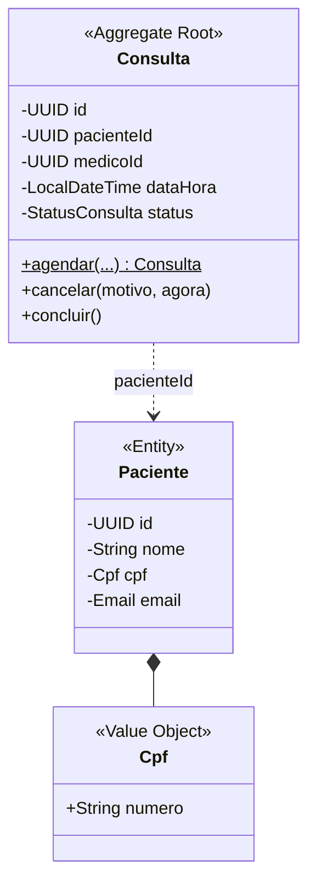

# Hands on: Diagramando e criando as classes com Java

**Live FIAP · Domain Driven Design com Java · Engenharia de Software**

Neste laboratório você vai modelar o domínio de uma clínica médica, desenhar o diagrama de classes, implementar as classes em **Java puro** com as regras de negócio dentro delas e, no fim, expor tudo como uma **API REST com Spring Boot**, sem alterar uma linha do domínio.

| | |
|---|---|
| **Duração** | ~2h |
| **Pré-requisitos** | JDK 21, Maven 3.9+, IntelliJ IDEA (ou VS Code), Git |
| **Repositório** | [prof-eduardo-ramos/ddd-java-clinica](https://github.com/prof-eduardo-ramos/ddd-java-clinica) |
| **Branch da atividade** | `lab/diagramando-classes-java` |
| **Branch com a solução** | `main` |
| **Atalhos** | tags `etapa-1`, `etapa-2`, `etapa-3`, `etapa-4` |

---

## Sumário

- [Etapa 0: Preparando o ambiente](#etapa-0-preparando-o-ambiente)
- [Etapa 1: Do problema ao modelo](#etapa-1-do-problema-ao-modelo)
- [Etapa 2: Objetos de valor com `record`](#etapa-2-objetos-de-valor-com-record)
- [Etapa 3: Entidades, agregado e caso de uso](#etapa-3-entidades-agregado-e-caso-de-uso)
- [Etapa 4: Evoluindo para uma API com Spring Boot](#etapa-4-evoluindo-para-uma-api-com-spring-boot)
- [Fechamento e próximos passos](#fechamento-e-próximos-passos)
- [Se você se perdeu](#se-você-se-perdeu)

---

## Etapa 0: Preparando o ambiente

### 0.1 Confira as ferramentas

```bash
java -version    # precisa mostrar 21
mvn -version     # precisa mostrar Maven 3.9+ usando Java 21
git --version
```

> Se `mvn -version` mostrar outro Java, ajuste a variável de ambiente `JAVA_HOME` para o JDK 21.

### 0.2 Clone o repositório e entre na branch da atividade

```bash
git clone https://github.com/prof-eduardo-ramos/ddd-java-clinica.git
cd ddd-java-clinica
git checkout lab/diagramando-classes-java
```

### 0.3 Rode os testes (eles DEVEM falhar)

```bash
mvn test
```

Os testes já estão escritos. Eles descrevem as regras do negócio. A sua missão é fazer todos ficarem **verdes**. Isso se chama trabalhar guiado por testes: o teste diz o que o código precisa fazer antes de o código existir.

### 0.4 Abra no IntelliJ

`File > Open` e selecione a pasta do projeto (o IntelliJ reconhece o `pom.xml`). A estrutura de pacotes já está criada:

```
src/main/java/br/com/fiap/clinica
├── domain
│   ├── model          ← entidades, objetos de valor, enums
│   ├── exception      ← RegraDeNegocioException
│   └── repository     ← interfaces (portas)
├── application        ← casos de uso (services)
├── infrastructure
│   └── persistence    ← repositórios em memória
└── demo               ← DemoJavaPuro (main)
```

**Checkpoint 0:** projeto aberto e `mvn test` executando (com falhas).

---

## Etapa 1: Do problema ao modelo

### 1.1 Leia o problema como o negócio conta

> "Nossa clínica atende **pacientes** com **médicos** de várias **especialidades**. O paciente **agenda uma consulta** com um médico em uma **data e hora**. A clínica funciona de **segunda a sábado, das 7h às 19h**, e cada consulta dura **1 hora**, sempre em hora cheia. Ninguém agenda em cima da hora: precisa de pelo menos **30 minutos de antecedência**. Um médico **não pode ter duas consultas no mesmo horário**. O paciente pode **cancelar**, mas precisa **informar o motivo** e avisar com **24 horas de antecedência**. Depois do atendimento, a consulta é **concluída**."

### 1.2 Substantivos viram classes, verbos viram métodos

Sublinhe os termos. Esse vocabulário compartilhado é a **linguagem ubíqua**: o mesmo nome na conversa, no diagrama e no código.

| Termo | Tipo DDD | Pergunta que decide |
|---|---|---|
| Paciente, Médico | **Entidade** | "Preciso distinguir um do outro ao longo do tempo?" Sim → tem **id** |
| Consulta | **Entidade + Agregado raiz** | Tem ciclo de vida e concentra as regras |
| CPF, E-mail, CRM | **Objeto de valor** | "Dois com o mesmo valor são a mesma coisa?" Sim → sem id, imutável |
| Especialidade, Status | **Enum** | Lista fechada de valores |
| agendar, cancelar, concluir | **Métodos** da Consulta | Comportamento junto dos dados |

### 1.3 Entidade x Objeto de valor

| Entidade | Objeto de valor |
|---|---|
| Tem identidade (`id`) | Não tem identidade |
| Igualdade pelo `id` | Igualdade pelo valor |
| Muda ao longo do tempo (mutável, de forma controlada) | Imutável: para "mudar", cria outro |
| Ex.: `Paciente` | Ex.: `Cpf` |

### 1.4 O diagrama de classes

Abra `docs/diagrama-de-classes.md` no GitHub ou no IntelliJ (com o plugin Mermaid) e veja o diagrama renderizado. O trecho principal:



Três decisões de modelagem para discutir:

1. **`Consulta` guarda `pacienteId`, e não o objeto `Paciente`.** Um agregado referencia outro agregado só pela identidade. Isso mantém cada agregado pequeno e independente.
2. **`agendar` é estático (`$`) e o construtor é privado.** Não existe consulta inválida: a única porta de entrada valida tudo.
3. **Atributos privados (`-`), métodos públicos (`+`).** Ninguém altera o `status` diretamente; só os métodos `cancelar()` e `concluir()`, que verificam as regras.

### 1.5 As cinco regras de negócio

| # | Regra | Onde vai morar |
|---|---|---|
| 1 | Antecedência mínima de 30 min para agendar | `Consulta.agendar()` |
| 2 | Segunda a sábado, 7h–19h, hora cheia (último horário 18h) | `Consulta.agendar()` |
| 3 | Médico sem duas consultas no mesmo horário | `ConsultaService.agendar()` |
| 4 | Cancelar exige motivo e 24h de antecedência | `Consulta.cancelar()` |
| 5 | Só consulta agendada pode ser concluída | `Consulta.concluir()` |

> **Por que a regra 3 não fica na `Consulta`?** Porque uma consulta não conhece as outras consultas. Quem tem acesso a todas é o repositório, e quem usa o repositório é o caso de uso (`ConsultaService`).

**Checkpoint 1:** você sabe dizer, para cada classe, se é entidade, objeto de valor ou enum, e onde cada regra vai morar.

---

## Etapa 2: Objetos de valor com `record`

Um `record` (Java 16+) é uma classe imutável que já vem com construtor, getters (`numero()`), `equals`, `hashCode` e `toString`. É o formato ideal para objeto de valor.

O **construtor compacto** (sem parênteses) roda antes de atribuir os campos: é o lugar perfeito para **validar e normalizar**. Se o objeto existe, ele é válido.

### 2.1 `Email`

Arquivo: `domain/model/Email.java`

```java
public record Email(String endereco) {

    private static final String FORMATO = "^[\\w.+-]+@[\\w-]+(\\.[\\w-]+)+$";

    public Email {
        if (endereco == null || endereco.isBlank()) {
            throw new RegraDeNegocioException("E-mail é obrigatório");
        }
        endereco = endereco.trim().toLowerCase();   // normaliza antes de guardar
        if (!endereco.matches(FORMATO)) {
            throw new RegraDeNegocioException("E-mail inválido: " + endereco);
        }
    }
}
```

### 2.2 `Crm` (objeto de valor composto)

O CRM só faz sentido com **número e UF** juntos. Por isso é um único objeto de valor com dois campos.

```java
public record Crm(String numero, String uf) {

    public Crm {
        if (numero == null || !numero.matches("\\d{4,6}")) {
            throw new RegraDeNegocioException("CRM deve ter de 4 a 6 dígitos");
        }
        if (uf == null || !uf.trim().matches("[A-Za-z]{2}")) {
            throw new RegraDeNegocioException("UF do CRM deve ter 2 letras");
        }
        uf = uf.trim().toUpperCase();
    }

    @Override
    public String toString() {
        return "CRM/" + uf + " " + numero;
    }
}
```

### 2.3 `Cpf`

Os métodos que calculam os dígitos verificadores já estão prontos. Complete apenas o construtor:

```java
public Cpf {
    if (numero == null || numero.isBlank()) {
        throw new RegraDeNegocioException("CPF é obrigatório");
    }
    numero = numero.replaceAll("\\D", ""); // remove pontos e traço
    if (!numero.matches("\\d{11}") || todosDigitosIguais(numero) || !digitosVerificadoresValidos(numero)) {
        throw new RegraDeNegocioException("CPF inválido: " + numero);
    }
}
```

### 2.4 Rode os testes da etapa

```bash
mvn test -Dtest=ObjetosDeValorTest
```

Repare no teste `cpfIgualdadePorValor`: `new Cpf("52998224725")` é igual a `new Cpf("529.982.247-25")`. O `record` compara pelo valor, e a normalização no construtor garantiu que o valor guardado é o mesmo.

**Checkpoint 2:** `ObjetosDeValorTest` verde (15 testes).

---

## Etapa 3: Entidades, agregado e caso de uso

### 3.1 Entidade `Paciente`

Use a classe `Medico` (já pronta) como referência. Três pontos importantes:

**a) Validação no construtor**

```java
private static String validarNome(String nome) {
    if (nome == null || nome.trim().length() < 3) {
        throw new RegraDeNegocioException("Nome do paciente deve ter ao menos 3 caracteres");
    }
    return nome.trim();
}
```

**b) Comportamento em vez de setter**

`setEmail()` diz *como* mudar. `alterarEmail()` diz *o que o negócio faz*. Esse é o oposto do **modelo anêmico** (classe só com getters e setters, com as regras espalhadas pelos services).

```java
public void alterarEmail(Email novoEmail) {
    this.email = Objects.requireNonNull(novoEmail, "E-mail é obrigatório");
}
```

**c) Igualdade pela identidade**

```java
@Override
public boolean equals(Object o) {
    return o instanceof Paciente outro && id.equals(outro.id);
}

@Override
public int hashCode() {
    return id.hashCode();
}
```

```bash
mvn test -Dtest=PacienteTest
```

### 3.2 Agregado `Consulta`: agendamento (regras 1 e 2)

O construtor é privado. A única forma de criar uma consulta é a fábrica estática `agendar()`. Repare que **o "agora" vem por parâmetro**: assim o teste controla o tempo e não depende do relógio do computador.

```java
public static Consulta agendar(UUID pacienteId, UUID medicoId, LocalDateTime dataHora, LocalDateTime agora) {
    Objects.requireNonNull(pacienteId, "Paciente é obrigatório");
    Objects.requireNonNull(medicoId, "Médico é obrigatório");
    Objects.requireNonNull(dataHora, "Data e hora são obrigatórias");
    Objects.requireNonNull(agora, "Data e hora atual são obrigatórias");

    validarAntecedencia(dataHora, agora);           // Regra 1
    validarHorarioDeFuncionamento(dataHora);        // Regra 2

    return new Consulta(pacienteId, medicoId, dataHora);
}

private static void validarAntecedencia(LocalDateTime dataHora, LocalDateTime agora) {
    if (agora.plus(ANTECEDENCIA_MINIMA_AGENDAMENTO).isAfter(dataHora)) {
        throw new RegraDeNegocioException("Consulta deve ser agendada com 30 minutos de antecedência");
    }
}

private static void validarHorarioDeFuncionamento(LocalDateTime dataHora) {
    if (dataHora.getDayOfWeek() == DayOfWeek.SUNDAY) {
        throw new RegraDeNegocioException("A clínica não funciona aos domingos");
    }
    LocalTime horario = dataHora.toLocalTime();
    if (horario.isBefore(PRIMEIRO_HORARIO) || horario.isAfter(ULTIMO_HORARIO)) {
        throw new RegraDeNegocioException("Consultas acontecem entre 7h e 19h (último horário: 18h)");
    }
    if (horario.getMinute() != 0 || horario.getSecond() != 0) {
        throw new RegraDeNegocioException("Consultas começam sempre em hora cheia (ex.: 09:00)");
    }
}
```

### 3.3 Agregado `Consulta`: cancelar e concluir (regras 4 e 5)

```java
public void cancelar(String motivo, LocalDateTime agora) {
    if (status != StatusConsulta.AGENDADA) {
        throw new RegraDeNegocioException("Só é possível cancelar uma consulta agendada");
    }
    if (motivo == null || motivo.isBlank()) {
        throw new RegraDeNegocioException("Motivo do cancelamento é obrigatório");
    }
    if (agora.plus(ANTECEDENCIA_MINIMA_CANCELAMENTO).isAfter(dataHora)) {
        throw new RegraDeNegocioException("Cancelamento exige 24 horas de antecedência");
    }
    this.status = StatusConsulta.CANCELADA;
    this.motivoCancelamento = motivo.trim();
}

public void concluir() {
    if (status != StatusConsulta.AGENDADA) {
        throw new RegraDeNegocioException("Só é possível concluir uma consulta agendada");
    }
    this.status = StatusConsulta.REALIZADA;
}
```

```bash
mvn test -Dtest=ConsultaTest
```

> **Reflexão:** não existe `setStatus()`. Tente, a partir de outra classe, colocar uma consulta cancelada como `REALIZADA`. Não dá. O agregado **protege suas invariantes**.

### 3.4 Caso de uso `ConsultaService` (regra 3)

O domínio define o contrato de persistência como interface (**porta**) em `domain/repository`:

```java
public interface ConsultaRepository {
    Consulta salvar(Consulta consulta);
    Optional<Consulta> buscarPorId(UUID id);
    List<Consulta> listarTodas();
    boolean existeConsultaAgendadaParaMedico(UUID medicoId, LocalDateTime dataHora);
}
```

Complete a implementação em memória (**adaptador**) em `infrastructure/persistence/ConsultaRepositoryEmMemoria.java`:

```java
@Override
public boolean existeConsultaAgendadaParaMedico(UUID medicoId, LocalDateTime dataHora) {
    return dados.values().stream()
            .anyMatch(c -> c.estaAgendada()
                    && c.getMedicoId().equals(medicoId)
                    && c.getDataHora().equals(dataHora));
}
```

E o caso de uso em `application/ConsultaService.java`. Ele recebe um `Clock` para saber "que horas são" de forma testável:

```java
public Consulta agendar(UUID pacienteId, UUID medicoId, LocalDateTime dataHora) {
    if (pacientes.buscarPorId(pacienteId).isEmpty()) {
        throw new RecursoNaoEncontradoException("Paciente não encontrado: " + pacienteId);
    }
    if (medicos.buscarPorId(medicoId).isEmpty()) {
        throw new RecursoNaoEncontradoException("Médico não encontrado: " + medicoId);
    }
    if (consultas.existeConsultaAgendadaParaMedico(medicoId, dataHora)) {
        throw new RegraDeNegocioException("Médico já possui consulta neste horário");
    }
    Consulta consulta = Consulta.agendar(pacienteId, medicoId, dataHora, LocalDateTime.now(relogio));
    return consultas.salvar(consulta);
}
```

### 3.5 Rode tudo e execute a demo

```bash
mvn test
```

Depois, rode `br.com.fiap.clinica.demo.DemoJavaPuro` pelo IntelliJ (botão ▶ ao lado do `main`). Saída esperada:

```
Consulta agendada para 2026-11-09T10:00 -> AGENDADA
Regra de negócio funcionando: Médico já possui consulta neste horário
Status após cancelamento: CANCELADA
```

Veja como a demo monta as dependências **na mão**:

```java
var consultaService = new ConsultaService(consultasRepo, pacientesRepo, medicosRepo, Clock.systemDefaultZone());
```

Guarde essa linha: na próxima etapa, o Spring vai fazer exatamente isso por você.

**Checkpoint 3:** `mvn test` todo verde (33 testes) e a demo rodando. Até aqui, **zero framework**.

---

## Etapa 4: Evoluindo para uma API com Spring Boot

Agora o Spring Boot entra como uma **casca** em volta do domínio. Regra de ouro desta etapa: **não altere nenhum arquivo de `domain` nem de `application`**.

### 4.1 Troque o `pom.xml`

O Spring Boot é só uma dependência. Substitua o `pom.xml` por:

```xml
<parent>
    <groupId>org.springframework.boot</groupId>
    <artifactId>spring-boot-starter-parent</artifactId>
    <version>4.1.1</version>
    <relativePath/>
</parent>

<groupId>br.com.fiap</groupId>
<artifactId>ddd-java-clinica</artifactId>
<version>1.0.0</version>

<properties>
    <java.version>21</java.version>
</properties>

<dependencies>
    <dependency>
        <groupId>org.springframework.boot</groupId>
        <artifactId>spring-boot-starter-webmvc</artifactId>
    </dependency>
    <dependency>
        <groupId>org.springframework.boot</groupId>
        <artifactId>spring-boot-starter-validation</artifactId>
    </dependency>
    <dependency>
        <groupId>org.springframework.boot</groupId>
        <artifactId>spring-boot-starter-webmvc-test</artifactId>
        <scope>test</scope>
    </dependency>
</dependencies>

<build>
    <plugins>
        <plugin>
            <groupId>org.springframework.boot</groupId>
            <artifactId>spring-boot-maven-plugin</artifactId>
        </plugin>
    </plugins>
</build>
```

> No IntelliJ, clique em **Load Maven Changes** (ícone do "m" com setas) depois de salvar.

### 4.2 Classe principal

`src/main/java/br/com/fiap/clinica/ClinicaApplication.java`

```java
@SpringBootApplication
public class ClinicaApplication {
    public static void main(String[] args) {
        SpringApplication.run(ClinicaApplication.class, args);
    }
}
```

### 4.3 Ligando as peças: `BeanConfig`

`infrastructure/config/BeanConfig.java`. Compare com a demo: é o **mesmo `new`**, só que agora quem chama é o Spring. Por isso domínio e application não precisam de nenhuma anotação.

```java
@Configuration
public class BeanConfig {

    @Bean
    public Clock relogio() {
        return Clock.system(ZoneId.of("America/Sao_Paulo"));
    }

    @Bean
    public PacienteRepository pacienteRepository() { return new PacienteRepositoryEmMemoria(); }

    @Bean
    public MedicoRepository medicoRepository() { return new MedicoRepositoryEmMemoria(); }

    @Bean
    public ConsultaRepository consultaRepository() { return new ConsultaRepositoryEmMemoria(); }

    @Bean
    public PacienteService pacienteService(PacienteRepository repository) {
        return new PacienteService(repository);
    }

    @Bean
    public MedicoService medicoService(MedicoRepository repository) {
        return new MedicoService(repository);
    }

    @Bean
    public ConsultaService consultaService(ConsultaRepository consultas, PacienteRepository pacientes,
                                           MedicoRepository medicos, Clock relogio) {
        return new ConsultaService(consultas, pacientes, medicos, relogio);
    }
}
```

### 4.4 DTOs: o que entra e o que sai da API

Pacote `web/dto`. DTO valida **formato** (campo preenchido); a **regra de negócio** continua no domínio.

```java
public record CadastrarPacienteRequest(
        @NotBlank String nome,
        @NotBlank String cpf,
        @NotBlank String email) {
}

public record PacienteResponse(UUID id, String nome, String cpf, String email) {
    public static PacienteResponse de(Paciente paciente) {
        return new PacienteResponse(paciente.getId(), paciente.getNome(),
                paciente.getCpf().formatado(), paciente.getEmail().endereco());
    }
}

public record AgendarConsultaRequest(
        @NotNull UUID pacienteId,
        @NotNull UUID medicoId,
        @NotNull LocalDateTime dataHora) {
}

public record CancelarConsultaRequest(@NotBlank String motivo) {
}
```

> Os demais DTOs (`CadastrarMedicoRequest`, `MedicoResponse`, `ConsultaResponse`) seguem o mesmo padrão. Veja na branch `main`.

### 4.5 Controller: fino, sem regra de negócio

`web/ConsultaController.java`

```java
@RestController
@RequestMapping("/consultas")
public class ConsultaController {

    private final ConsultaService service;

    public ConsultaController(ConsultaService service) {   // injeção pelo construtor
        this.service = service;
    }

    @PostMapping
    public ResponseEntity<ConsultaResponse> agendar(@RequestBody @Valid AgendarConsultaRequest request) {
        var consulta = service.agendar(request.pacienteId(), request.medicoId(), request.dataHora());
        var uri = ServletUriComponentsBuilder.fromCurrentRequest()
                .path("/{id}").buildAndExpand(consulta.getId()).toUri();
        return ResponseEntity.created(uri).body(ConsultaResponse.de(consulta));
    }

    @GetMapping
    public List<ConsultaResponse> listar() {
        return service.listar().stream().map(ConsultaResponse::de).toList();
    }

    @GetMapping("/{id}")
    public ConsultaResponse buscar(@PathVariable UUID id) {
        return ConsultaResponse.de(service.buscar(id));
    }

    @PostMapping("/{id}/cancelamento")
    public ConsultaResponse cancelar(@PathVariable UUID id, @RequestBody @Valid CancelarConsultaRequest request) {
        return ConsultaResponse.de(service.cancelar(id, request.motivo()));
    }

    @PostMapping("/{id}/conclusao")
    public ConsultaResponse concluir(@PathVariable UUID id) {
        return ConsultaResponse.de(service.concluir(id));
    }
}
```

`PacienteController` e `MedicoController` seguem o mesmo formato (`POST`, `GET`, `GET /{id}`).

### 4.6 Traduzindo exceções do domínio em HTTP

`web/handler/TratadorDeErros.java`. O domínio lança `RegraDeNegocioException`; a camada web decide que isso vira **422**. Usamos o formato padrão **Problem Details (RFC 9457)**.

```java
@RestControllerAdvice
public class TratadorDeErros {

    @ExceptionHandler(RegraDeNegocioException.class)
    public ProblemDetail regraDeNegocio(RegraDeNegocioException e) {
        var problema = ProblemDetail.forStatusAndDetail(HttpStatus.UNPROCESSABLE_CONTENT, e.getMessage());
        problema.setTitle("Regra de negócio violada");
        return problema;
    }

    @ExceptionHandler(RecursoNaoEncontradoException.class)
    public ProblemDetail naoEncontrado(RecursoNaoEncontradoException e) {
        var problema = ProblemDetail.forStatusAndDetail(HttpStatus.NOT_FOUND, e.getMessage());
        problema.setTitle("Recurso não encontrado");
        return problema;
    }

    @ExceptionHandler(MethodArgumentNotValidException.class)
    public ProblemDetail dadosInvalidos(MethodArgumentNotValidException e) {
        var problema = ProblemDetail.forStatusAndDetail(HttpStatus.BAD_REQUEST, "Dados de entrada inválidos");
        problema.setTitle("Requisição inválida");
        problema.setProperty("campos", e.getBindingResult().getFieldErrors().stream()
                .map(erro -> erro.getField() + ": " + erro.getDefaultMessage())
                .toList());
        return problema;
    }
}
```

| Situação | Exceção | HTTP |
|---|---|---|
| Campo obrigatório faltando no JSON | `MethodArgumentNotValidException` | 400 |
| Paciente/médico/consulta não existe | `RecursoNaoEncontradoException` | 404 |
| Regra de negócio violada (CPF inválido, domingo, conflito...) | `RegraDeNegocioException` | 422 |

### 4.7 Suba a aplicação e teste

```bash
mvn spring-boot:run
```

Use o arquivo `requests.http` da raiz (IntelliJ executa direto) ou `curl`:

```bash
# 1. Paciente
curl -i -X POST localhost:8080/pacientes -H "Content-Type: application/json" \
  -d '{"nome":"Ana Souza","cpf":"529.982.247-25","email":"ana@email.com"}'

# 2. Médico
curl -i -X POST localhost:8080/medicos -H "Content-Type: application/json" \
  -d '{"nome":"Carlos Lima","crm":"123456","uf":"SP","especialidade":"CARDIOLOGIA"}'

# 3. Consulta (troque os ids e use uma data futura, seg-sáb, hora cheia)
curl -i -X POST localhost:8080/consultas -H "Content-Type: application/json" \
  -d '{"pacienteId":"<ID>","medicoId":"<ID>","dataHora":"2026-12-07T10:00:00"}'

# 4. Regra de negócio violada -> 422
curl -i -X POST localhost:8080/pacientes -H "Content-Type: application/json" \
  -d '{"nome":"Teste","cpf":"111.111.111-11","email":"teste@email.com"}'
```

Resposta do passo 4:

```json
{
  "title": "Regra de negócio violada",
  "status": 422,
  "detail": "CPF inválido: 11111111111",
  "instance": "/pacientes"
}
```

A mensagem veio **do record `Cpf`** que você escreveu na Etapa 2.

### 4.8 Teste de ponta a ponta

Crie `src/test/java/br/com/fiap/clinica/web/ConsultaControllerTest.java` (copie da branch `main`) e rode:

```bash
mvn test
```

**Checkpoint 4:** 36 testes verdes e a API respondendo. Confira com `git diff etapa-3 -- src/main/java/br/com/fiap/clinica/domain`: **nenhuma mudança no domínio**.

---

## Fechamento e próximos passos

O que vimos:

1. **Linguagem ubíqua**: o vocabulário do negócio virou nome de classe e de método.
2. **Objetos de valor** (`record`) que se validam sozinhos.
3. **Entidades** com identidade e **comportamento** em vez de setters.
4. **Agregado** que protege suas regras e referencia outros agregados por id.
5. **Portas e adaptadores**: o domínio define a interface, a infraestrutura implementa.
6. **Spring Boot como detalhe**: entrou no fim, sem tocar no domínio.

Próximos passos:

- Trocar os repositórios em memória por **Spring Data JPA + H2/PostgreSQL** (só a infraestrutura muda).
- Adicionar **eventos de domínio** (ex.: `ConsultaCancelada` dispara um e-mail).
- Documentar a API com **OpenAPI/Swagger**.

---

## Se você se perdeu

Cada etapa tem uma tag com o código pronto até aquele ponto:

```bash
git stash                     # guarda o que você fez
git checkout etapa-2          # ou etapa-3, etapa-4
```

Para voltar à sua versão: `git checkout lab/diagramando-classes-java && git stash pop`.
