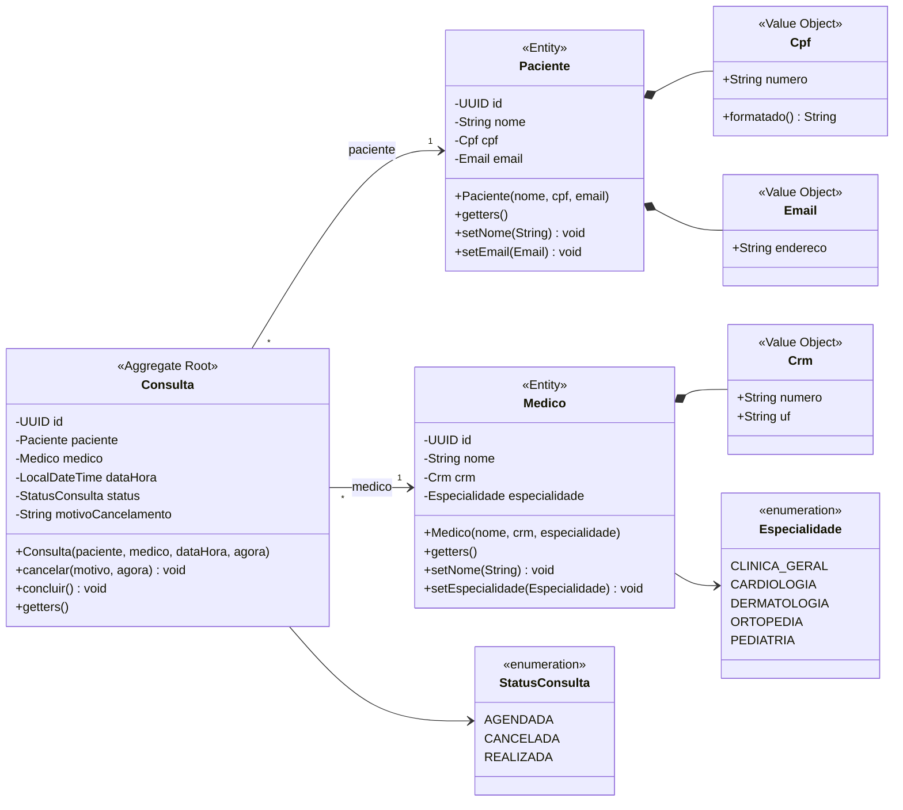
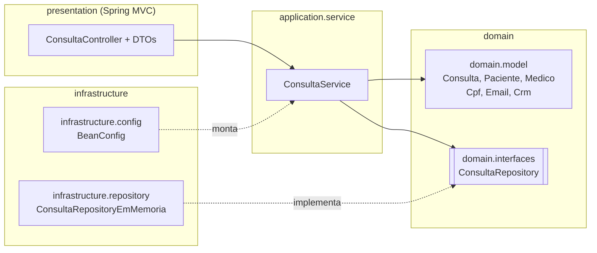

# Diagrama de classes

O diagrama está em [Mermaid](https://mermaid.js.org/): é texto, fica versionado no Git junto com o código e o GitHub desenha automaticamente.

## Modelo de domínio

### Como ler

- **Linha cheia com losango (`*--`)**: composição. O CPF faz parte do paciente e não existe sozinho no modelo.
- **Seta cheia (`-->`) com `1` e `*`**: associação. Toda `Consulta` **tem um** `Paciente` e **tem um** `Medico` (atributos do tipo dessas classes); um paciente ou médico pode ter **várias** consultas. Pelo objeto, navegamos: `consulta.getPaciente().getNome()`.
- **`-` e `+`**: atributos privados (encapsulamento) e métodos públicos.
- **Setters só quando fazem sentido**: o nome e o e-mail do paciente podem mudar; o `id` e o CPF, não. A `Consulta` não tem setters: o status só muda por `cancelar()` e `concluir()`.

## Camadas (Clean Architecture)

**Regra de dependência:** as setas apontam sempre para dentro, em direção ao domínio. O domínio não conhece ninguém: nem Spring, nem banco, nem HTTP.
