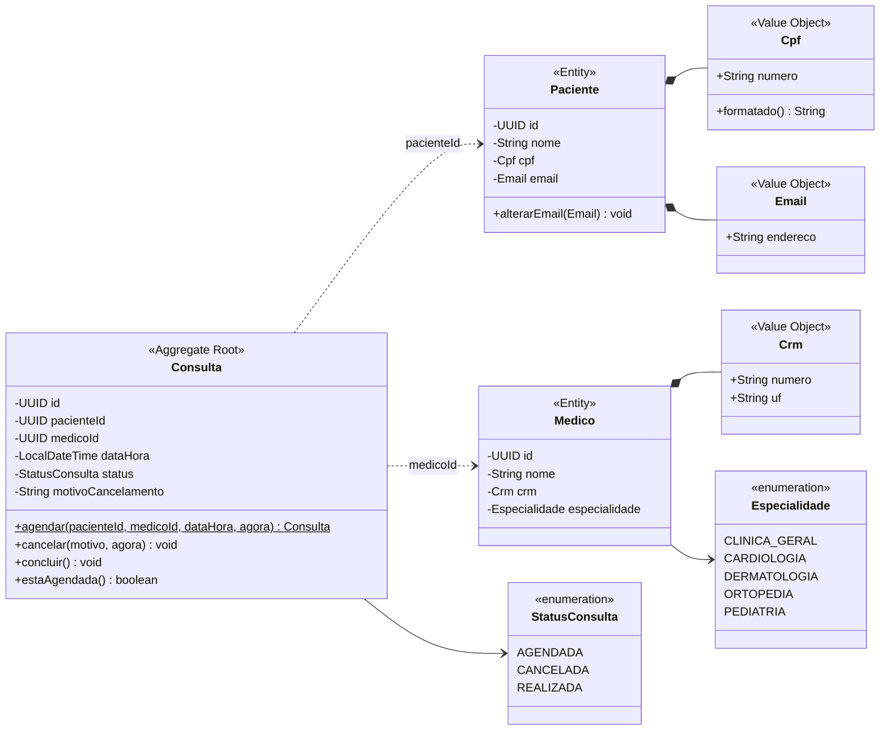
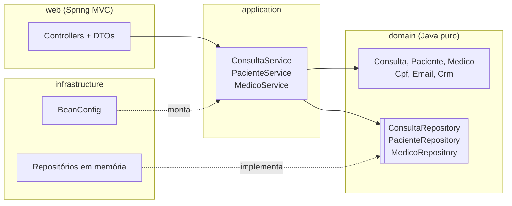

# Diagrama de classes

O diagrama está em [Mermaid](https://mermaid.js.org/): é texto, fica versionado no Git junto com o código e o GitHub desenha automaticamente.

## Modelo de domínio

### Como ler

- **Linha cheia com losango (`*--`)**: composição. O CPF faz parte do paciente e não existe sozinho no modelo.
- **Linha tracejada (`..>`)**: a `Consulta` só guarda o **id** do paciente e do médico. Um agregado não carrega outro agregado inteiro dentro de si; ele aponta pela identidade.
- **`$`** no método `agendar`: método estático (fábrica). O construtor é privado, então toda consulta nasce validada.
- **`-` e `+`**: atributos privados (encapsulamento) e métodos públicos (comportamento).

## Camadas (Clean Architecture)

**Regra de dependência:** as setas apontam sempre para dentro, em direção ao domínio. O domínio não conhece ninguém: nem Spring, nem banco, nem HTTP.
